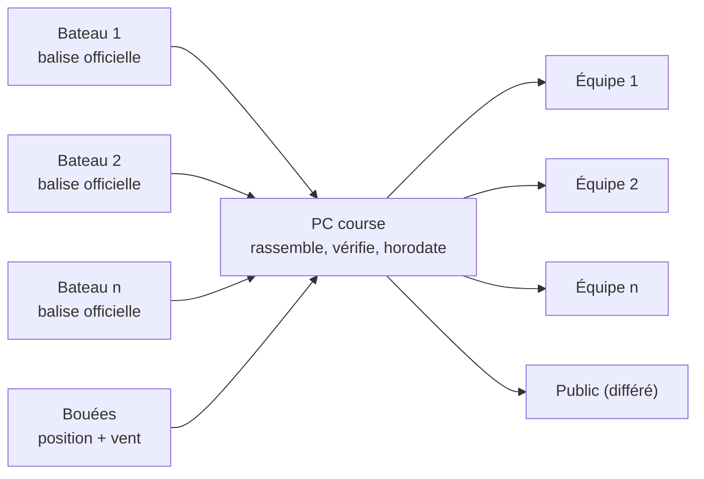
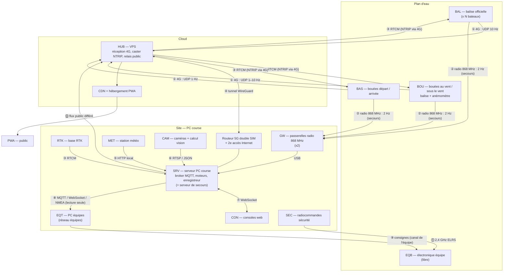
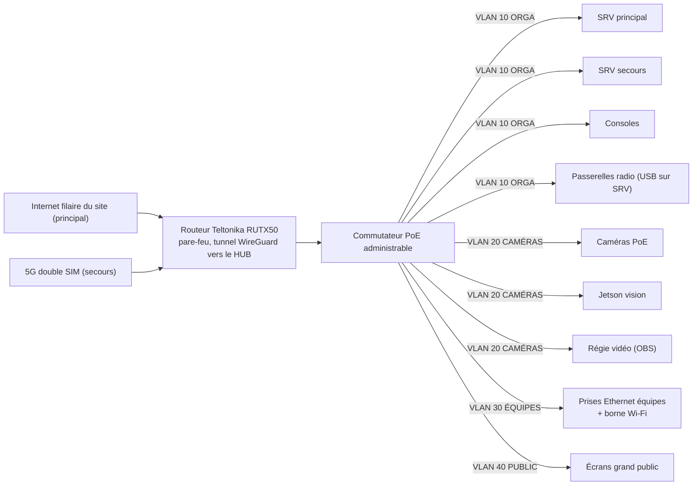

# AI Regatta — Matériel et communications

> Les références de matériel à jour (uniquement du matériel bien noté) sont dans [materiel.md](materiel.md) et dans la présentation interactive.

> Version 0.1, 19 novembre 2026. Complète l'[étude préalable](etude-prealable.md).
> Les prix sont des prix publics constatés fin 2026, TTC, en ordre de grandeur. Ils varient selon le revendeur et le pack.
> **[À TESTER]** signale un choix à confirmer lors des essais sur l'eau.

## Ce qui est acté

- Le plan d'eau est choisi et validé ; la réglementation n'est pas traitée ici.
- **Le PC course diffuse à toutes les équipes** les positions des bouées, les positions de tous les bateaux et les données de vent.
- Le format de course est défini ; il comporte **du près et du portant** (donc une bouée au vent et une bouée ou porte sous le vent, toutes deux instrumentées en vent).
- **L'architecture des bateaux est libre.** L'organisation impose seulement la balise officielle et le plan de fréquences.
- Le logiciel sera développé avec de l'IA agentique (approche GSD).
- **Moins de 10 bateaux.** Une balise de 250 g est acceptable.
- **Distance maximale PC course ↔ parcours : 500 m.**
- **Électricité et Internet filaire disponibles** sur le site.
- **La position de chaque bateau est fournie par une balise officielle** identique pour tous, fournie et fixée par l'organisation (option A, décidée le 19 novembre 2026). Les positions envoyées par l'électronique des équipes ne servent ni au suivi, ni au classement, ni à l'arbitrage.
- **Pas de sortie de données de la balise officielle vers l'électronique des équipes** : chaque équipe a son propre GPS et sa propre liaison avec son bateau. La balise officielle ne sert qu'à l'organisation (suivi, classement, arbitrage).

## Décisions du 20 novembre 2026

- **Lieu** : anse du Mourillon, entre le Fort Saint-Louis et la petite digue de l'anse Mistral (43,107199 N, 5,941540 E). Le parcours fera **environ 200 m** de long (longueur retenue, à valider).
- **Dates** : inscriptions et homologation du 12 au 14 mai 2027 ; régates le samedi 15 mai ; report possible le dimanche 16 jusqu’à 14 h 30 (règlement de l’organisateur).
- **Balise** : à l'intérieur du bateau si possible (voir la note sur les coques en carbone au §4.1).
- **Caméras** : 12 m de hauteur au maximum.
- **Bouées** : ancrées (pas de bouées robotisées), avec mesure du vent.
- **Sécurité** : assurée par des bateaux d'assistance. La reprise en main à distance n'est pas obligatoire.
- **Équité** : toutes les équipes reçoivent exactement les mêmes informations de positionnement, par le flux officiel. Pas de partage séparé des corrections RTK.
- **Équipes** : toutes sur place. Pas de miroir cloud du flux équipes.
- **Pas d'assistant tactique fourni** : la tactique est le rôle des équipes.
- **Public** : sur place, et application PWA (iPhone, ordinateur). Commentateur humain en français.
- **Règles de course et arbitrage** : à définir plus tard, arbitrage probablement en temps réel à terre.
- **Logiciel non open source.**

### La foule peut-elle gêner la 4G ?

Oui, c'est un risque réel. Tous les téléphones du public partagent la même antenne relais que les balises. Quand des centaines de personnes envoient des vidéos ou regardent l'application au même endroit, l'antenne sature, surtout en émission (du téléphone vers l'antenne) : la latence monte de quelques dizaines de millisecondes à plusieurs secondes, et des paquets se perdent.

Ce qui joue en notre faveur : les balises envoient très peu de données (environ 0,4 ko/s chacune) et en petits paquets UDP, qui passent mieux que la vidéo. À quelques centaines de spectateurs, le risque est modéré ; à plusieurs milliers, il devient fort.

Parades prévues ou proposées :
1. **La radio privée 868 MHz n'est pas touchée par la foule** : elle prend le relais à 2 positions par seconde, sans rien faire.
2. **SIM multi-opérateurs** : la balise bascule sur un autre réseau si le sien sature.
3. **Mesure en conditions réelles** : tester les balises un week-end ensoleillé d'avril, plage du Mourillon pleine.
4. **Option à tester : Wi-Fi longue portée de l'ESP32** (mode « LR » intégré à la puce de la balise, sans surcoût). À 300 m, une borne au PC course pourrait servir de chemin principal privé. La bande 2,4 GHz est elle aussi encombrée par les téléphones, d'où l'intérêt de la tester avant de décider.
5. **Ne pas faire passer le flux équipes par la 4G** : il passe déjà par câble sur le site.
6. **Pour le public sur place, prévoir une application légère** (positions seulement, la vidéo à part) et, si le budget le permet, un Wi-Fi public au village.

---

## Principe central : le flux des positions



1. **Chaque bateau envoie sa position au PC course**, 10 fois par seconde, par sa balise officielle.
2. **Le PC course rassemble les positions de tous les bateaux et des bouées**, avec le vent mesuré.
3. **Le PC course renvoie le tout à toutes les équipes en même temps** : chaque équipe reçoit la position de tous les bateaux, la sienne comprise, au même instant et dans le même format.
4. Les équipes n'échangent jamais de données entre elles : tout passe par le PC course.

---

## Sommaire

1. [Les entités du système](#1-les-entités-du-système)
2. [Schéma des communications](#2-schéma-des-communications)
3. [Les liaisons une par une](#3-les-liaisons-une-par-une)
4. [Matériel : références recommandées](#4-matériel--références-recommandées)
5. [Liaison radio privée : conception](#5-liaison-radio-privée--conception)
6. [Réseau à terre](#6-réseau-à-terre)
7. [Formats de messages](#7-formats-de-messages)
8. [Pannes et modes dégradés](#8-pannes-et-modes-dégradés)
9. [Plan de fréquences](#9-plan-de-fréquences)
10. [Nomenclature chiffrée](#10-nomenclature-chiffrée)
11. [Développement en IA agentique : ce qui change](#11-développement-en-ia-agentique--ce-qui-change)
12. [Questions restantes](#12-questions-restantes)

---

## 1. Les entités du système

| Code | Entité | Où | Qui la fournit | Rôle |
|---|---|---|---|---|
| **BAL** | Balise officielle | Sur chaque bateau | Organisation (prêtée, scellée) | Position RTK, cap, gîte, horodatage ; émission vers le PC course |
| **BOU** | Bouée instrumentée | Bouée au vent, bouée/porte sous le vent | Organisation | Balise + anémomètre + compas : position de la bouée et vent mesuré |
| **BAS** | Balise de bouée simple | Bouées de départ et d'arrivée | Organisation | Position seule |
| **RTK** | Station de base RTK | Point fixe à terre | Organisation | Corrections centimétriques pour toutes les balises ; temps de référence |
| **GW** | Passerelle radio | Mât ou toit à terre | Organisation | Réception de la radio privée de secours |
| **SRV** | Serveur PC course | PC course | Organisation | Bus de données, moteur de course, moteur vent, enregistreur |
| **CON** | Consoles | PC course | Organisation | Direction de course, arbitrage, sécurité, régie |
| **CAM** | Nœud caméra | Point haut | Organisation | Vidéo live, analyse des risées |
| **MET** | Station météo | Point haut à terre | Organisation | Vent de référence, tendance |
| **HUB** | Hub cloud | Serveur virtuel (VPS) | Organisation | Point de rendez-vous 4G, caster RTK, relais public |
| **PWA** | Application publique | Téléphones, écrans | Organisation | Visualisation live et replay |
| **EQT** | PC à terre de l'équipe | Zone équipes | Équipe | Reçoit le flux de course, calcule, envoie ses consignes |
| **EQB** | Électronique de bord de l'équipe | Sur le bateau | Équipe (libre) | Pilotage, voiles, exécution des consignes |
| **SEC** | Radiocommande de sécurité | Zone équipes / officier sécurité | Équipe, homologuée par l'organisation | Reprise en main, arrêt |

Principe : **les entités de l'organisation (BAL, BOU, BAS, RTK, GW, SRV) forment le système officiel**, indépendant de l'électronique des équipes. Une équipe dont l'électronique tombe en panne reste suivie et classée.

---

## 2. Schéma des communications



---

## 3. Les liaisons une par une

| # | De → vers | Support | Protocole | Cadence | Latence visée | Contenu |
|---|---|---|---|---|---|---|
| ① | BAL / BOU / BAS → HUB | 4G LTE Cat-1 | UDP, trames binaires signées (HMAC) | 10 Hz bateaux ; 1 Hz bouées (+ vent 1–4 Hz) | 50–150 ms | Position, vitesse, cap, gîte, qualité RTK, batterie, vent pour les bouées |
| ② | BAL / BOU / BAS → GW | Radio privée 868 MHz (sous-bande 869,4–869,65 MHz) | Trame binaire compacte, multiplexage temporel calé sur la seconde GNSS | 2 Hz | < 1 s | Position compacte + état. **Chemin de secours, indépendant d'Internet** |
| ③ | RTK → SRV → HUB → balises | Série USB, puis tunnel, puis 4G | RTCM 3 (messages MSM4/MSM7 + 1005/1230) diffusé par un caster NTRIP | 1 Hz | < 1 s | Corrections RTK. Secours : base publique Centipede directement depuis la balise |
| ④ | HUB ↔ site | Internet (5G + 2e accès) | Tunnel WireGuard ; à l'intérieur : UDP relayé + pont MQTT | Continu | 20–50 ms | Les trames ① arrivent sur le SRV ; le flux public ⑫ repart vers le cloud |
| ⑤ | MET → SRV | Wi-Fi / Ethernet local | API HTTP locale de la station, convertie en MQTT | 0,1–1 Hz | — | Vent, rafales, pression, température |
| ⑥ | CAM → SRV | Ethernet (PoE) ou faisceau Wi-Fi 5 GHz | RTSP (H.264/H.265) pour la vidéo ; MQTT/JSON pour les résultats de vision | 25–30 i/s ; 1 Hz pour les risées | — | Vidéo live ; carte des risées ; position/orientation PTZ (ONVIF) |
| ⑦ | SRV ↔ CON | Réseau local orga | WebSocket (JSON) + API HTTP | Temps réel | < 100 ms | Toutes les données ; commandes de direction de course (séquence, parcours, pénalités) |
| ⑧ | SRV → EQT | Réseau local équipes (Ethernet, même longueur de câble pour tous) ; toutes les équipes sont sur place (P13) | MQTT : lecture du flux, écriture dans la seule boîte d’envoi (un compte par équipe) ; WebSocket JSON ; flux NMEA 0183 / Signal K en option | 10 Hz bateaux, 1 Hz vent | < 50 ms en local | Positions de tous les bateaux, bouées, vent mesuré et carte de vent, état de la course, événements, classement |
| ⑨ | EQT → EQB | **Au choix de l'équipe** (4G, radio de télémétrie) | Au choix (MAVLink, MQTT, propriétaire) | — | — | Consignes de l'équipe. L'organisation n'intervient pas, sauf plan de fréquences |
| ⑪ | SEC → EQB | 2,4 GHz, saut de fréquence | ExpressLRS (ELRS) | 50–150 Hz | < 20 ms | Reprise en main manuelle, mode sécurité |
| ⑫ | SRV → HUB → PWA | Internet | WebSocket diffusé par le cloud (CDN) ; fichiers de replay sur stockage objet | 1–2 Hz, différé de 1 s (P30) | ≈ 1 s | Flux public agrégé : positions lissées, classement, vent, événements |

### Pourquoi ce découpage

- **La 4G est le chemin principal** : elle est simple, offre un gros débit (10 Hz) et transporte nativement les corrections RTK et les mises à jour à distance des balises. En rade de Toulon, à quelques kilomètres du rivage, la couverture est bonne **[À TESTER sur le plan d'eau]**.
- **La radio 868 MHz est le chemin de secours** : à 2 Hz pour les bateaux, sans dépendre d'Internet ni des opérateurs, elle suffit pour que le classement et la sécurité continuent si la 4G ou Internet tombe.
- **Un hub cloud sert de point de rendez-vous** : les balises en 4G ne peuvent pas joindre directement un PC derrière un routeur 5G. Le VPS reçoit les trames et les renvoie au site par un tunnel chiffré. C'est aussi lui qui sert le public, ce qui évite que des milliers de spectateurs chargent la connexion du site.
- **Les équipes reçoivent le flux en local, par câble** : même latence pour tous, aucune dépendance à Internet. Toutes les équipes sont sur place (P13) : pas de miroir cloud.
- **Le canal de consignes reste à la main des équipes** (architecture libre). La balise officielle n'a aucun lien électrique avec l'électronique de l'équipe : elle est autonome (sa propre batterie) et se fixe simplement sur le bateau.

---

## 4. Matériel : références recommandées

### 4.1 Balise officielle (BAL) — objectif : moins de 250 g, 10 h d'autonomie

| Fonction | Référence recommandée | Prix indicatif | Alternative |
|---|---|---|---|
| GNSS RTK | **ArduSimple simpleRTK2B Lite** (u-blox ZED-F9P, bi-bande L1/L2) | ≈ 190–210 € | **ArduSimple simpleRTK3B Budget** (Unicore UM980, tri-bande, ≈ 250 €) ; SparkFun GPS-RTK-SMA (ZED-F9P) |
| Antenne GNSS | **u-blox ANN-MB-00** (L1/L2, magnétique, IP67), sur plan de masse de 10 cm | ≈ 50–60 € | Antenne hélicoïdale L1/L2 légère si la place manque en tête de mât **[À TESTER]** |
| Microcontrôleur + 4G | **LilyGO T-A7670E-S3** (ESP32-S3 + modem SIMCom A7670E LTE Cat-1, lecteur de carte microSD) | ≈ 35–50 € | LilyGO T-SIM7600E (Cat-4) ; ESP32-S3 + modem séparé |
| Radio de secours 868 MHz | **Adafruit RFM95W** (Semtech SX1276, 20 dBm), le même module dans les récepteurs du PC course | ≈ 20 € | EByte E22-900M22S (SX1262) |
| Antenne 868 | Antenne fouet 868 MHz ½ onde, connecteur SMA | ≈ 5–10 € | — |
| Cap / gîte / tangage | **Adafruit BNO085** (fusion IMU + magnétomètre), en liaison série, mode UART-RVC (l’I2C pose problème sur ESP32) | ≈ 25 € | ICM-20948 ; double antenne GNSS (ArduSimple simpleRTK2B + F9H) si le cap magnétique est perturbé (+ 250 €) |
| SIM | SIM IoT multi-opérateurs (1NCE, Things Mobile) | 10–20 € pour la saison | Une SIM d'un autre opérateur sur quelques balises de rechange |
| Énergie | 2 × accus 18650 de 3 500 mAh (≈ 25 Wh) + carte de charge/protection | ≈ 20 € | Batterie LiPo 1S 5 000 mAh |
| Boîtier | Boîtier ABS IP67 (gamme Hammond 1554 ou équivalent) + traversées SMA + presse-étoupe + interrupteur magnétique (ILS) | ≈ 25 € | Boîtier imprimé en ASA avec joint torique |
| Connecteur de charge | Connecteur étanche M8 | ≈ 10 € | — |
| **Total par balise** | | **≈ 380–450 €** | |

**Balise à l'intérieur du bateau** : le GPS et la 4G traversent sans problème une coque ou un pont en fibre de verre, en bois ou en plastique. **Le carbone bloque les ondes** : sur un bateau en carbone, l'antenne GPS doit sortir sur le pont (antenne plate collée, câble vers la balise) **[À TESTER dès le prototype, sur un vrai bateau]**.

**Implantation à bord (poids en bas)** :
- Boîtier (batterie + électronique, ≈ 170 g) au fond, près de la quille, sanglé et scellé. Il peut être sous la flottaison : seule la position des antennes compte.
- Antennes au-dessus de la flottaison **et dans l'axe du bateau** : à la gîte, une antenne collée sur le côté sous le vent passe sous l'eau, et l'eau de mer coupe toute liaison.
- Rien au-dessus de l'antenne GPS (batterie, servo, carbone) ; 10–15 cm au moins d'un mât carbone ; 10 cm entre l'antenne GPS et l'antenne 4G.
- **Fibre de verre ou bois** : antenne GPS hélicoïdale légère juste sous le pont, antennes 4G et 868 MHz souples collées sous le pont. Rien ne dépasse. Total ≈ 210–230 g.
- **Carbone** : antennes sur le pont (GPS sous un petit dôme, 4G et 868 MHz courtes), câbles par passe-coque étanche ; ou mieux, une fenêtre en fibre de verre d'environ 8 × 15 cm dans le pont, antennes collées dessous. Total ≈ 230–260 g.
- La distance antenne → étrave est mesurée au contrôle d'équipement ; le PC course en déduit la position de l'étrave avec le cap.

**Consommation estimée** : environ 1,2 W en moyenne (4G active, GNSS, radio en émission 1 % du temps). Avec 25 Wh, cela donne **une vingtaine d'heures**, avec une large marge sur une journée de course **[À TESTER]**.

**Pourquoi le ZED-F9P plutôt que l'UM980 ?** Les deux conviennent. Le F9P a l'écosystème le plus riche (documentation, bibliothèques ESP32, retours de terrain). L'UM980 capte une bande de plus et coûte à peu près autant. **Retenu : le ZED-F9P** (simpleRTK2B Lite), sur toutes les balises ; le prototype compare deux cartes 4G (Waveshare et LilyGO). Ce qui compte, c'est d'avoir **le même récepteur sur toutes les balises**, pour l'équité.

### 4.2 Bouées instrumentées (BOU)

| Fonction | Référence recommandée | Prix indicatif | Remarque |
|---|---|---|---|
| Balise | Balise officielle (4.1), en boîtier plus grand | ≈ 400 € | Même firmware, profil "bouée" |
| Anémomètre | **Gill WindSonic M** | ≈ 1 300 € (sur devis) | Ultrasonique, sans pièce mobile, éprouvé en mer ; sortie RS-232, convertisseur 3,3 V vers la balise ; alimentation 12,8 V |
| Compas de la bouée | BNO085 de la balise | inclus | **Indispensable** : l’anémomètre donne la direction du vent par rapport à son propre axe, et la bouée tourne sur son mouillage |
| Énergie | Batterie LiFePO4 12,8 V 6 Ah étanche + une de rechange ; pas de panneau solaire (la bouée tourne sur son mouillage) | ≈ 120 € | Une journée de course avec une large marge ; recharge chaque soir |
| Structure | Espar lesté porte-capteur, anémomètre à 2 m de hauteur, sur bouée de régate gonflable ou flotteur dédié | 150–300 € | Un espar lesté bouge beaucoup moins qu'une bouée gonflable seule |
| **Total par bouée instrumentée** | | **≈ 1 200–1 400 €** | |

Le moteur vent corrige la mesure avec le roulis, le tangage et le cap de la bouée, puis la moyenne sur 5 à 10 secondes.

### 4.3 Bouées de départ et d'arrivée (BAS)

Balise officielle en profil "bouée", sans anémomètre : **≈ 400 €** par bouée, plus la bouée elle-même.

### 4.4 Option : bouées robotisées

| Fonction | Référence | Prix indicatif |
|---|---|---|
| Propulsion | 2 × **Blue Robotics T200** + 2 contrôleurs moteur (ESC) Blue Robotics Basic ESC | ≈ 450–500 € |
| Pilote | Contrôleur **Matek H743** (ou Holybro Pixhawk 6C) sous **ArduPilot Rover**, mode bateau, maintien en position | ≈ 100–200 € |
| Position | La balise officielle de la bouée fournit la position RTK au pilote par une liaison interne (bouée de l'organisation) | — |
| Énergie | Batterie LiFePO4 12,8 V 20 Ah | ≈ 150 € |
| Flotteur + structure | Fabrication | 300–600 € |
| **Total** | | **≈ 1 500–2 000 € par bouée** (en plus de la balise) |

La direction de course déplace la bouée au vent depuis sa console quand le vent tourne.

### 4.5 Station de base RTK (RTK)

| Fonction | Référence | Prix indicatif |
|---|---|---|
| Récepteur | **ArduSimple simpleRTK2B** (même famille que les balises) ou simpleRTK3B | ≈ 200–250 € |
| Antenne | Antenne géodésique tri-bande ArduSimple (type "survey"), fixée sur un support rigide dégagé | ≈ 150–250 € |
| Liaison | USB vers le serveur ; le serveur publie le flux RTCM vers le caster NTRIP du hub | — |
| Temps | Le récepteur donne l’heure GPS au serveur (chrony) : impulsion de seconde si la carte la sort, sinon messages GPS, à quelques millisecondes près | — |
| **Total** | | **≈ 400–500 €** |

Le point d'installation de l'antenne est relevé une fois pour toutes (relevé de plusieurs heures, ou rattachement au réseau Centipede).

### 4.6 Passerelles radio (GW)

| Fonction | Référence | Prix indicatif |
|---|---|---|
| Radio | 2 × **Heltec WiFi LoRa 32 V3** (ESP32-S3 + SX1262), utilisées comme modems USB | ≈ 2 × 25 € |
| Antenne | Antenne colinéaire 868 MHz en fibre de verre, 5–6 dBi | ≈ 60–100 € |
| Câble | Coaxial faible perte (LMR-400 ou équivalent), le plus court possible | ≈ 40 € |
| Mât | À 500 m, un mât de 4–6 m (ou un toit) suffit largement | ≈ 50–100 € |
| **Total** | | **≈ 250–300 €** |

Deux passerelles en parallèle : si l'une tombe, l'autre continue. Le serveur supprime les doublons grâce aux numéros de séquence.

### 4.7 PC course : serveur, réseau, énergie

| Fonction | Référence | Prix indicatif |
|---|---|---|
| Serveur principal | Mini-PC type **ASUS NUC 14 Pro** (Core i7, 32 Go, SSD 1 To), Linux | ≈ 800–1 000 € |
| Serveur de secours | Identique, en secours chaud (abonné au même flux, prend le relais en quelques secondes) | ≈ 800–1 000 € |
| Routeur Internet | **Teltonika RUTX50** (5G, double SIM, bascule automatique, 5 ports Gigabit) | ≈ 450–550 € |
| Accès Internet | **Accès filaire du site en principal**, 5G du routeur en secours automatique | abonnement du site + 2 SIM |
| Commutateur | Commutateur administrable PoE 8–16 ports (gamme TP-Link Omada ou Ubiquiti UniFi), pour séparer orga / équipes / caméras | ≈ 150–300 € |
| Wi-Fi zone équipes | Borne Wi-Fi extérieure (Ubiquiti UniFi U6 Mesh ou équivalent), en plus des prises Ethernet | ≈ 150–200 € |
| Faisceau vers le point haut caméra | Paire **Ubiquiti LiteBeam 5AC Gen2** (si le point haut est à distance du PC course) | ≈ 150–200 € la paire |
| Énergie de secours | Station d'énergie à fonction onduleur (EcoFlow River 2 Pro, Bluetti ou équivalent), 700–1 000 Wh | ≈ 400–600 € |
| Écrans consoles | 2–3 écrans 27" | ≈ 450 € |
| **Total** | | **≈ 3 500–4 500 €** |

### 4.8 Caméras et vision (CAM)

| Fonction | Référence | Prix indicatif |
|---|---|---|
| Caméra principale | Caméra PTZ IP 4 Mpx, zoom 25×, ONVIF, PoE+ (gamme **Hikvision DS-2DE4425IW-DE** ou Dahua équivalent). ONVIF donne l'orientation, utile pour la réalité augmentée | ≈ 500–700 € |
| Caméra large fixe | Caméra IP 4K à objectif fixe grand angle, pour l'analyse des risées (image stable) | ≈ 200–400 € |
| Filtre | Filtre polarisant circulaire adapté (réduit les reflets, augmente le contraste des risées) | ≈ 30–60 € |
| Calcul vision | **NVIDIA Jetson Orin Nano Super Developer Kit** au point haut, ou PC avec carte RTX au PC course | ≈ 250–300 € |
| Réalisation vidéo | **OBS Studio** sur un mini-PC de régie (le même que les serveurs), qui lit la caméra par le réseau ; diffusion RTMP/SRT vers YouTube Live. L’ATEM Mini Pro est écarté : il n’accepte pas la vidéo par le réseau | ≈ 930 € |
| **Total** | | **≈ 1 300–1 800 €** |

Hauteur visée pour l'analyse des risées : **20 m minimum, 40 m idéalement**.

### 4.9 Station météo à terre (MET)

| Référence | Prix indicatif | Intérêt |
|---|---|---|
| **Ecowitt WS90** (capteur ultrasonique 7-en-1) + passerelle **Ecowitt GW2000** | ≈ 200–250 € | Peu coûteux, API locale sur le réseau (pas de dépendance au cloud) |
| Alternative : Davis Vantage Pro2 | ≈ 700–900 € | Référence historique, plus robuste |

### 4.10 Caméras embarquées (option)

| Référence | Prix indicatif | Remarque |
|---|---|---|
| **DJI O4 Air Unit** + lunettes ou récepteur DJI au PC course | ≈ 100 € par bateau + récepteur | Bonne image, liaison numérique, 5,8 GHz |
| Walksnail Avatar HD Mini 1S | ≈ 90 € par bateau | Alternative légère |

Contraintes : 20 à 40 g, environ 4 à 8 W pendant l'émission. Réservé aux bateaux qui peuvent l'embarquer.

### 4.11 Matériel de sécurité (SEC), homologué par l'organisation

| Référence | Prix indicatif |
|---|---|
| Émetteur **RadioMaster Pocket ELRS** ou **RadioMaster Boxer ELRS** | ≈ 70–150 € |
| Récepteur **RadioMaster ER6** (sorties PWM, pour des servos ou un relais) ou **RP3** (sortie série vers un autopilote) | ≈ 20–30 € |

Règle proposée : chaque bateau embarque un récepteur ELRS appairé à un émetteur tenu par l'équipe. Une voie est réservée au **mode sécurité** (choquer les voiles, se mettre face au vent ou s'arrêter). Le fonctionnement est vérifié au contrôle d'équipement.

### 4.12 Kit de référence proposé aux équipes (optionnel, l'architecture reste libre)

| Fonction | Référence | Prix indicatif |
|---|---|---|
| Autopilote | **Matek H743-SLIM** ou **H743-WING V3** sous **ArduPilot Rover, mode voilier** (girouette, réglage de voile, virements automatiques, navigation par waypoints) | ≈ 80–120 € |
| Girouette | Capteur d'angle magnétique AS5600 sur une girouette imprimée en 3D | ≈ 10–20 € |
| Calcul embarqué (pour l'IA à bord) | Raspberry Pi Zero 2 W ou Raspberry Pi 5 / CM5 | ≈ 20–90 € |
| Position | GPS propre à l'équipe (module u-blox M10 à ≈ 20 €, ou RTK ZED-F9P si l'équipe le souhaite ; les corrections RTK de la base officielle peuvent être mises à disposition de tous sur le réseau) | 20–250 € |
| Liaison consignes | Modem 4G USB, ou paire de radios de télémétrie Holybro SiK 868 MHz (MAVLink) | ≈ 40–70 € |
| Treuil de voile | Servo-treuil de voile (gammes Hitec ou RMG) | ≈ 60–150 € |

ArduPilot gère nativement les voiliers : un virement peut être déclenché par une commande, et en mode automatique le bateau tire des bords tout seul pour atteindre un waypoint au vent.

---

## 5. Liaison radio privée : conception

### 5.1 Choix de la bande : 868 MHz, sous-bande 869,4–869,65 MHz

| Critère | 868 MHz, sous-bande "g3" | 2,4 GHz |
|---|---|---|
| Puissance autorisée | 500 mW PIRE | 100 mW PIRE, à condition d'utiliser le saut de fréquence ; sinon nettement moins |
| Temps d'émission autorisé | 10 % par appareil | Pas de limite équivalente |
| Portée sur l'eau avec une antenne basse | Excellente | Correcte |
| Encombrement | Faible | Fort (téléphones du public, radiocommandes ELRS, Wi-Fi) |
| Débit | Faible | Élevé |

**Choix : 868 MHz** pour la radio de secours (portée, peu d'encombrement, conception simple sur un canal fixe). La bande 2,4 GHz reste libre pour les radiocommandes de sécurité.

### 5.2 Multiplexage temporel calé sur le temps GNSS

Toutes les balises connaissent l'heure GNSS à une ou deux millisecondes près : chaque position du récepteur porte son heure GPS, et la balise cale son horloge sur l'arrivée de ces messages (la carte Lite ne sort pas l'impulsion de seconde). Avec des messages de 12 octets (≈ 21 ms d'antenne, largeur 250 kHz) et 5 ms de garde, c'est assez. Chaque seconde est découpée en créneaux, et chaque balise émet dans **son** créneau. Il n'y a donc pas de collisions, sans aucune coordination.

```
Seconde GNSS (1 000 ms)
| 0–30 ms   | 30–60 ms | 60–90 ms  | ... | 930–960 ms | 960–990 ms  |
| GW balise | BAL 01   | BAL 02    | ... | BOU / BAS  | réserve     |
```

- Réglage radio : 869,525 MHz, LoRa SF7, largeur de bande 250 kHz. Une trame de 12 octets dure environ 21 ms ; un créneau de 30 ms laisse la marge de garde.
- **Capacité : 33 créneaux par seconde.** Les 10 bateaux émettent 2 fois par seconde (2 Hz), les bouées une fois toutes les 5 s : le canal est occupé à ≈ 45 %.
- Temps d'émission par bateau à 2 Hz : ≈ 42 ms par seconde, soit **≈ 4 %** (sous la limite de 10 %).
- Créneau 0 : la passerelle diffuse l'état de la course (chrono, rappels) et un accusé de réception groupé. Ce message court peut servir à faire clignoter une LED sur la balise au moment d'un rappel.
- **Les corrections RTK ne passent pas par cette radio** : le débit et la limite de 10 % ne le permettent pas à 1 Hz. Si la 4G tombe, la balise garde la précision RTK pendant 10 à 60 s environ, puis passe progressivement en précision métrique. C'est acceptable en secours.

### 5.3 Bilan de liaison (ordre de grandeur)

Distance maximale de 500 m, 868 MHz : affaiblissement en espace libre ≈ 85 dB. Émission 20 dBm + antenne bateau 2 dBi + antenne à terre 5 dBi − 85 dB − 3 dB de pertes de câble ≈ **−61 dBm reçus**. La sensibilité en SF7 / 250 kHz étant d'environ −121 dBm, **la marge est d’environ 60 dB**. La portée n'est pas un sujet à cette distance ; il reste à vérifier les masquages (coques, voiles) et les réflexions sur l'eau **[À TESTER]**.

À 500 m, on pourrait aussi faire de la radio privée le chemin principal. On garde la 4G en principal parce qu'elle transporte en plus les corrections RTK et les mises à jour à distance des balises.

---

## 6. Réseau à terre



Règles :
- **Les équipes (VLAN 30) n'atteignent que le broker du SRV, en lecture seule.** Elles ont aussi accès à Internet (pour leurs propres liaisons 4G ou cloud), avec un débit garanti par équipe.
- **Les caméras (VLAN 20) sont isolées**, car la vidéo est gourmande.
- **Les deux serveurs partagent une adresse IP virtuelle** (keepalived) : en cas de panne du principal, les consoles et les équipes basculent sans rien reconfigurer.
- **Temps** : le SRV est synchronisé sur l’heure GPS de la base RTK et sert de serveur NTP pour tout le réseau local, équipes comprises.

### Logiciels de la chaîne (tous open source)

| Rôle | Logiciel |
|---|---|
| Broker | **Mosquitto** (ou EMQX) |
| Caster NTRIP | **RTKLIB str2str** ou SNIP, sur le HUB ; flux source depuis la base via le tunnel |
| Tunnel | **WireGuard** |
| Relais public | Serveur WebSocket (Node.js uWebSockets, ou Centrifugo) derrière **Cloudflare** |
| Hébergement PWA et replays | Cloudflare Pages + R2 (ou Vercel + stockage S3) |
| Temps | **chrony** + heure GPS de la base |
| Vidéo | **OBS Studio**, flux RTSP des caméras, diffusion vers YouTube Live |
| Vision | OpenCV, éventuellement un réseau de segmentation sur le Jetson |
| Compatibilité équipes | Pont vers **Signal K** et NMEA 0183 sur TCP/UDP, pour brancher des logiciels de navigation existants (OpenCPN, logiciels tactiques compatibles NMEA) |

---

## 7. Formats de messages

### 7.1 Trame 4G balise → HUB (UDP, 48 octets, binaire petit-boutiste)

| Octets | Champ | Type | Unité |
|---|---|---|---|
| 0 | version + type de trame | u8 | — |
| 1 | identifiant balise | u8 | — |
| 2–3 | numéro de séquence | u16 | — |
| 4–7 | temps GNSS (ms depuis le début de la semaine GPS) | u32 | ms |
| 8–11 | latitude | i32 | 1e-7 degré |
| 12–15 | longitude | i32 | 1e-7 degré |
| 16–17 | vitesse fond (SOG) | u16 | cm/s |
| 18–19 | route fond (COG) | u16 | 0,01 degré |
| 20–21 | cap | u16 | 0,01 degré |
| 22 | gîte | i8 | degré |
| 23 | tangage | i8 | degré |
| 24 | type de solution (aucune / 3D / DGNSS / RTK flottant / RTK fixe) + nombre de satellites | u8 | — |
| 25 | précision horizontale estimée | u8 | cm (saturé à 255) |
| 26 | batterie | u8 | % |
| 27 | qualité 4G (RSSI) | u8 | — |
| 28–39 | champ libre : vent pour les bouées (vitesse, direction vraie), drapeaux d'état | — | — |
| 40–47 | signature HMAC-SHA256 tronquée à 8 octets (clé propre à chaque balise) | — | — |

La signature empêche qu'une trame soit falsifiée ou rejouée par un tiers.

### 7.2 Trame radio 868 MHz (12 octets)

Identifiant (1 octet), temps en dixièmes de seconde dans la minute et drapeaux (2), latitude et longitude en écart par rapport à un point de référence du plan d'eau (2 × 3 octets, au centimètre près), vitesse (1), route (1), type de solution, batterie et réserve (1). Le contrôle d’erreur est celui de LoRa ; il n’y a pas de signature : le récepteur n’accepte une trame que dans le créneau de sa balise et la compare à la dernière position 4G. Détail : `fabrication-balise.md`.

### 7.3 Flux interne et flux équipes (MQTT, JSON)

Sujets :

```
race/{raceId}/state                  # séquence de départ, chrono, manche, statut
race/{raceId}/clock                  # heure GPS du départ, étape de la procédure, rappels (message conservé)
race/{raceId}/course                 # bouées, portes, ligne de départ/arrivée, limites
race/{raceId}/marks/{markId}         # position + vent mesuré (vitesse, direction vraie, rafale)
race/{raceId}/boats/{boatId}/pos     # position officielle 10 Hz
race/{raceId}/wind/field             # carte de vent fusionnée (grille), 1 Hz
race/{raceId}/wind/trend             # tendance bascule / renforcement à 5–15 min
race/{raceId}/events                 # départ, OCS, passage de bouée, pénalité, arrivée
race/{raceId}/leaderboard            # classement live
sys/beacons/{beaconId}/health        # état des balises (réservé à l'orga)
```

Exemple de position diffusée aux équipes :

```json
{
  "boatId": "FRA-07",
  "t": "2027-05-15T13:42:07.200Z",
  "lat": 43.10512345,
  "lon": 5.93876543,
  "fix": "rtk_fixed",
  "hAcc_m": 0.02,
  "sog_kn": 3.42,
  "cog": 247.1,
  "hdg": 251.0,
  "heel": 14.2,
  "path": "4g"
}
```

Exemple de mesure de vent à une bouée :

```json
{
  "markId": "WW",
  "t": "2027-05-15T13:42:07.000Z",
  "lat": 43.1102, "lon": 5.9411,
  "tws_kn": 9.8, "twd": 132.5,
  "gust_kn": 12.1, "twd_std": 6.2,
  "avg_s": 10
}
```

Le flux NMEA proposé en option reprend les mêmes données en phrases standard (positions des autres bateaux en messages AIS encapsulés `!AIVDM`, vent en `MWV`/`MWD`). La plupart des logiciels de navigation savent les afficher directement.

---

## 8. Pannes et modes dégradés

| Panne | Effet | Ce qui continue | Parade |
|---|---|---|---|
| 4G perdue sur un bateau | Plus de trames 10 Hz ni de corrections RTK pour ce bateau | Radio 868 à 2 Hz ; précision RTK conservée 10 à 60 s environ, puis ≈ 1 m | Carte SD complète récupérée après la course |
| Internet filaire du site coupé | Aucun, si la 5G prend le relais | Tout | Bascule automatique du routeur sur la 5G (double SIM) |
| Internet totalement coupé (filaire + 5G) | Plus de trames 4G au SRV, plus de flux public | Radio 868 pour toutes les balises ; flux local aux équipes ; RTK via la base Centipede directement depuis les balises | Rare : il faut perdre les deux accès à la fois |
| HUB cloud indisponible | Idem coupure Internet pour le chemin 4G | Idem | 2e VPS de secours (adresse configurée dans les balises) |
| Serveur PC course en panne | Consoles et flux équipes interrompus quelques secondes | Le HUB et les balises enregistrent tout | Serveur de secours chaud + adresse IP virtuelle |
| Passerelle radio en panne | Plus de chemin de secours | 4G | 2e passerelle |
| Base RTK en panne | Plus de corrections | Base Centipede via le HUB ou les balises | Basculement automatique du point de montage NTRIP |
| Balise d'un bateau morte | Bateau absent du suivi | Le reste de la flotte | 2 balises de rechange, remplacement entre deux manches ; reconstitution par la vidéo si besoin |
| Panne électrique au PC course | — | Station d'énergie (onduleur) pendant 1 à 2 h | Groupe électrogène ou second circuit |

---

## 9. Plan de fréquences

| Usage | Bande | Qui | Règle |
|---|---|---|---|
| Radio de secours officielle | 869,4–869,65 MHz | Organisation | **Réservée** : interdite aux équipes |
| Télémétrie / consignes des équipes | 433 MHz, 863–869,2 MHz, ou 4G | Équipes | Canal déclaré à l'inscription, puissance maximale fixée |
| Radiocommandes de sécurité | 2,4 GHz, ExpressLRS en saut de fréquence | Équipes | Conseillée (P16) ; déclarée et homologuée au contrôle si installée |
| Vidéo embarquée | 5,8 GHz | Équipes ou orga | Canaux attribués par l'organisation |
| Faisceau caméra et Wi-Fi local | 5 GHz | Organisation | Canaux choisis après un relevé du spectre sur le site |

Une **mesure du spectre** sur le site (petit analyseur type TinySA Ultra, environ 150 €) est conseillée lors de l'essai de janvier et le matin de chaque journée de course.

---

## 10. Nomenclature chiffrée

Exemple pour **10 bateaux au maximum**, 2 bouées instrumentées (au vent, sous le vent), 2 bouées de ligne, sans bouée robotisée.

| Poste | Quantité | Prix unitaire | Total |
|---|---|---|---|
| Balises officielles (10 + 2 de rechange) | 12 | 420 € | 5 040 € |
| Bouées instrumentées vent | 2 | 1 300 € | 2 600 € |
| Balises de bouées de ligne | 2 | 420 € | 840 € |
| Base RTK | 1 | 450 € | 450 € |
| Passerelles radio + antenne + petit mât | 1 lot | 250 € | 250 € |
| PC course (2 serveurs, routeur, commutateur, Wi-Fi, onduleur, écrans) | 1 lot | 4 000 € | 4 000 € |
| Caméras + vision + régie | 1 lot | 1 500 € | 1 500 € |
| Station météo | 1 | 230 € | 230 € |
| Analyseur de spectre | 1 | 150 € | 150 € |
| Prototypes (2 GNSS de chaque famille, modules radio, IMU, 1 anémomètre de test) | 1 lot | 1 200 € | 1 200 € |
| Imprévus (≈ 10 %) | | | 1 600 € |
| **Total matériel** | | | **≈ 17 900 €** |
| Fonctionnement : SIM, VPS, Cloudflare, API LLM (6 mois) | | | ≈ 500–1 000 € |

Options : bouées robotisées (+ 1 500–2 000 € chacune), caméras embarquées (+ ≈ 100 € par bateau + récepteurs), 2e caméra PTZ (+ 600 €).

### Commande prototype à passer maintenant

- 2 × ArduSimple simpleRTK2B Lite + 1 × simpleRTK3B Budget
- 3 × antennes u-blox ANN-MB-00 + 1 antenne géodésique pour la base
- 3 × LilyGO T-A7670E-S3
- 4 × EByte E22-900M22S + 2 × Heltec WiFi LoRa 32 V3
- 3 × Adafruit BNO085
- L’anémomètre Gill WindSonic M est commandé sur devis avec la série, en février
- 3 × SIM IoT (2 opérateurs différents)
- Boîtiers IP67, accus 18650, connecteurs M8
- 1 × TinySA Ultra

Le budget est d’environ 1 900 € (commande de décembre). Il faut compter 1 à 3 semaines de délai selon les fournisseurs.

---

## 11. Développement en IA agentique : ce qui change

Le développement agentique comprime fortement l'écriture du code. **Les estimations en jours de l'étude préalable sont à diviser par un facteur important** pour tout ce qui est logiciel pur : moteur de course, API, consoles web, PWA, simulateur, relais cloud. Un ordre de grandeur réaliste, pour une ou deux personnes qui pilotent les agents :

| Bloc | Estimation |
|---|---|
| Socle : broker, formats, enregistreur, simulateur, SDK | 1 à 2 semaines |
| Moteur de course + consoles | 2 à 3 semaines |
| PWA publique (carte live, classement, replay) | 1 à 2 semaines |
| Moteur vent, arbitrage assisté, aides au commentateur | 2 à 3 semaines |

**Ce que les agents n'accélèrent pas, et qui fixe donc le vrai calendrier :**
1. **Les délais de livraison du matériel.**
2. **Le firmware sur le vrai matériel** : réglage du GNSS, du modem 4G, du multiplexage radio, de la consommation. Chaque itération passe par un banc de test physique.
3. **Les essais sur l'eau** : couverture 4G réelle, portée radio, mouvement des bouées, étanchéité, calibration des caméras. Il faut compter une sortie toutes les 2 à 3 semaines, qui dépend de la météo.
4. **La mise au point avec des données réelles** : moteur vent, détection des risées, seuils d'arbitrage.

**Pour que l'approche GSD fonctionne bien**, le dépôt doit contenir dès le départ des spécifications par module (ce document, le contrat d'interface du §7 et les règles du moteur de course), un **simulateur qui produit des données réalistes** pour que les agents testent sans bateau, et des **jeux de données enregistrés lors des essais**, qui servent de tests de non-régression.

Conséquence sur le planning : le logiciel peut être prêt très tôt (dès fin janvier pour le socle). **Le chemin critique devient le cycle matériel → essai sur l'eau → correction.** Il faut donc multiplier les sorties sur l'eau entre janvier et avril.

---

## 12. Questions restantes

Réponses obtenues le 19 novembre 2026 : balise de 250 g acceptable ; moins de 10 bateaux ; 500 m au maximum entre le PC course et le parcours ; pas de sortie de données de la balise vers les équipes ; électricité et Internet filaire disponibles.

Questions encore ouvertes :

1. **Où fixer la balise sur le bateau** : en tête de mât (meilleure réception GPS, mais en hauteur et soumise à la gîte) ou sur le pont (plus stable, mais la voile masque une partie du ciel) ? Il faut aussi définir un point de référence commun (étrave, mât) pour l'arbitrage.
2. **Hauteur et emplacement du point haut** pour les caméras. À 500 m, 20 m de hauteur suffisent pour bien voir le parcours.
3. **Équipes à distance** : réglé, toutes les équipes sont sur place (P13) ; pas de miroir cloud.
4. **Corrections RTK pour les équipes** : met-on le flux de corrections de la base officielle à disposition de toutes les équipes sur le réseau ? Cela leur permet d'avoir leur propre GPS centimétrique à moindre coût, à égalité.
5. **Bouées robotisées** : à inclure dès 2027 ou à garder pour une édition suivante ?

---

## Sources consultées pour les références et les prix

- ArduSimple, simpleRTK2B / simpleRTK3B : https://www.ardusimple.com/product/simplertk3b-budget
- Calypso ULP STD (UART/I²C, RS485) : https://citimarinestore.com/en/calypso-marine-wind-instruments/15323-calypso-ultra-low-power-ultrasonic-wind-meter-ulp-std-45ms-uart-cmi1018.html
- Calypso, gamme portable solaire : https://www.marinesuperstore.com/marine-instruments/wind-instruments/calypso-ultrasonic-portable-solar-powered-wind-meter
- EByte E28 (SX1280/SX1281, 2,4 GHz), envisagé puis écarté pour la radio de secours : https://www.lcsc.com/product-detail/C411311.html
- LilyGO T-A7670E-S3 : https://www.tindie.com/products/lilygo/t-a7670esa-s3-standard-development-board/ et https://wiki.lilygo.cc/get_started/en/SIM/T-A7670/T-A7670E/T-A7670E.html
- Teltonika RUTX50 : https://galaxus.fr/en/s1/product/teltonika-rutx50-routers-22566042
- ArduPilot Rover, mode voilier : https://ardupilot.org/rover/docs/sailboat-configure.html et https://ardupilot.org/rover/docs/sailboat-modes.html

Les autres prix sont des ordres de grandeur que je n'ai pas vérifiés un par un, à confirmer au moment de commander.
