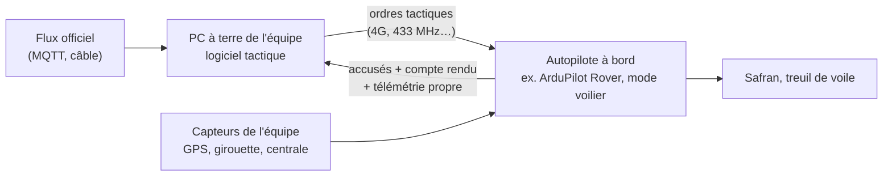

# AI Regatta — Communiquer avec votre bateau

> Version 1.0-draft, 20 novembre 2026. Concerne la **liaison 7** (« consignes de l’équipe vers son bateau ») de [liaisons-et-logiciel.md](../liaisons-et-logiciel.md#7-consignes-de-léquipe-vers-son-bateau-flux-essentiel).
> Les points marqués **« à trancher par l’organisation »** sont des propositions, pas encore des règles.

## 1. Qui fait quoi

| | Organisation | Équipe |
|---|---|---|
| Position officielle du bateau | Balise officielle, scellée, autonome | — |
| Flux de course (positions, vent, chrono…) | Fourni à toutes les équipes, par câble | Le reçoit sur son PC à terre |
| **Liaison PC à terre → bateau** | Fixe seulement le plan de fréquences et les règles d’usage | **Entièrement à sa charge** : matériel, logiciel, réglages, fiabilité (P10, P36) |
| Électronique de bord (autopilote, capteurs, servos) | — | Libre (P07) |
| Tactique | Aucun assistant fourni (P12) | C’est son travail |
| Sécurité sur l’eau | Bateaux d’assistance (P16) | Comportement du bateau en cas de perte de liaison, déclaré à l’avance |

**La balise officielle n’a aucun lien avec votre électronique** (P09) : elle a sa propre batterie, ne reçoit rien de votre bateau et ne vous transmet rien. Votre bateau reste suivi et classé même si toute votre électronique tombe en panne. Inversement, la position de votre propre GPS ne sert ni au suivi, ni au classement, ni à l’arbitrage (P08).

## 2. Les fréquences

### 2.1 Supports autorisés

| Support | Bandes | Statut | Remarques |
|---|---|---|---|
| **4G / 5G** (modem USB, routeur, carte SIM) | Réseaux des opérateurs | Autorisé | Simple et sans réglage radio ; la foule peut saturer l’antenne relais (voir l’architecture, « La foule peut-elle gêner la 4G ? »). Prévoyez un mode dégradé |
| **Radio de télémétrie 433 MHz** (type SiK, Holybro, RFD) | 433,05–434,79 MHz | Autorisé, **déclaration obligatoire** | Bon compromis portée / débit à 150–500 m ; attention, la plupart de ces radios sortent d’usine à une puissance **supérieure** à la limite européenne : réglez-la |
| **Radio 868 MHz** (SiK 868, LoRa…) | 863–869,2 MHz et 869,7–870 MHz | Autorisé, **déclaration obligatoire** | **Interdit dans la sous-bande 869,4–869,65 MHz**, réservée à la radio de secours des balises officielles. Le temps d’émission autorisé (0,1 à 1 %) est très faible pour une télémétrie continue |
| **2,4 GHz** (Wi-Fi, ExpressLRS, Bluetooth) | 2 400–2 483,5 MHz | Autorisé, **déclaration obligatoire** | Bande très encombrée le jour J : téléphones du public, radiocommandes de sécurité, Wi-Fi. Ne comptez pas sur elle seule pour vos ordres |
| **5,8 GHz** (vidéo embarquée) | 5 725–5 875 MHz | À confirmer dans le plan de fréquences | Le plan actuel (architecture §9) prévoit des canaux attribués par l’organisation |
| **5 GHz Wi-Fi** | 5 150–5 350 et 5 470–5 725 MHz | Réservé à l’organisation sur le site (faisceau caméra, Wi-Fi local), canaux choisis après relevé du spectre | Pas d’usage équipe sans accord |

### 2.2 Limites de puissance et de temps d’émission

Valeurs de référence de la réglementation européenne des « appareils de faible portée » (recommandation CEPT ERC 70-03, reprise en France par les décisions de l’Arcep). **L’organisation vérifiera les valeurs en vigueur avant l’épreuve (à confirmer).**

| Bande | Puissance maximale | Temps d’émission maximal | Commentaire |
|---|---|---|---|
| 433,05–434,79 MHz | 10 mW PAR | 10 % | Réglage courant d’une radio SiK : 20 dBm (100 mW), **à baisser** à 10 dBm au plus, gain d’antenne compris |
| 863–865 MHz | 25 mW PAR | 0,1 % | |
| 865–868 MHz | 25 mW PAR | 1 % | |
| 868,0–868,6 MHz | 25 mW PAR | 1 % | |
| 868,7–869,2 MHz | 25 mW PAR | 0,1 % | |
| **869,4–869,65 MHz** | — | — | **Réservée à l’organisation : interdite aux équipes** |
| 869,7–870 MHz | 5 mW PAR (25 mW à 1 %) | Sans limite à 5 mW | |
| 2 400–2 483,5 MHz | 100 mW PIRE | Sans limite pour le Wi-Fi et le saut de fréquence | Réglez ExpressLRS et le Wi-Fi à 100 mW au plus |
| 5 725–5 875 MHz | 25 mW PIRE | — | Vidéo : canal attribué par l’organisation (à confirmer) |

Vocabulaire : **PAR** (puissance apparente rayonnée, *ERP*) et **PIRE** (puissance isotrope rayonnée équivalente, *EIRP*) mesurent la puissance réellement envoyée dans l’air, **gain de l’antenne compris** (PIRE ≈ PAR + 2,15 dB). Le **temps d’émission** (*duty cycle*) est la part du temps pendant laquelle l’émetteur peut parler : 1 %, c’est 36 secondes par heure au total.

Conséquence pratique : en 868 MHz, hors de la sous-bande réservée, un flux de télémétrie MAVLink continu **dépasse** vite la limite de 1 %. Pour une liaison bavarde, préférez la **433 MHz** (10 %) ou la **4G**.

### 2.3 Déclaration obligatoire à l’inscription

Chaque équipe déclare, pour **chaque émetteur** embarqué ou à terre : le type de matériel, la bande et le canal (ou la plage de saut de fréquence), la puissance réglée, l’antenne, et l’usage (ordres, télémétrie, vidéo, sécurité). L’organisation peut attribuer des canaux pour éviter que deux équipes se gênent, et vérifier les réglages au contrôle (mesure au spectre, architecture §9). Tout changement après l’inscription doit être déclaré avant d’être utilisé.

## 3. Architecture recommandée



- **À terre** : le PC de l’équipe reçoit le flux officiel, décide de la tactique et envoie des **ordres simples**.
- **À bord** : un autopilote **exécute** ces ordres de façon autonome (barre, réglage de voile, virement). Le pilotage fin doit rester à bord : la latence de la liaison (et ses coupures) ne doit jamais faire perdre le contrôle du bateau.
- Exemple éprouvé, cité dans le kit de référence (architecture §4.12) : **ArduPilot Rover en mode voilier**, sur un contrôleur de vol de type Matek H743, avec une girouette, piloté par **MAVLink** (le protocole de messages d’ArduPilot) sur une radio de télémétrie. ArduPilot sait déjà virer sur commande et tirer des bords seul vers un point au vent. Une architecture maison (Raspberry Pi, microcontrôleur, protocole propre) est tout aussi acceptable.

## 4. Les ordres tactiques

### 4.1 La liste des ordres

Les équipes envoient à leur bateau des ordres tactiques simples (P36). Ils se rangent en deux familles : les **manœuvres**, ponctuelles, et les **modes**, qui restent actifs jusqu’à l’ordre suivant. Le pilote automatique à bord exécute ; l’ordre ne fait que le déclencher. Cette liste est la référence commune ; l’organisation pourra la compléter avant le gel du 15 mars 2027.

**Manœuvres**

| Ordre | Code proposé | Effet attendu | Paramètre facultatif |
|---|---|---|---|
| Vire | `tack` | Virement de bord (l’avant du bateau passe face au vent) | — |
| Empanne | `gybe` | Empannage (l’arrière du bateau passe face au vent) | — |
| Abats | `bear_away` | Contournement de la **bouée au vent** : une fois la bouée passée, le bateau s’écarte du vent pour partir au portant | `mark_id`, `side` (côté de passage) |
| Loffe | `head_up` | Contournement de la **bouée sous le vent** (ou de la porte) : une fois la bouée passée, le bateau remonte vers le vent pour repartir au près | `mark_id`, `side` |
| Face au vent | `head_to_wind` | Le bateau se met bout au vent et s’arrête, voiles qui faseyent (attente avant le départ, sécurité, ralentir) | `duration_s` |

**Modes**

| Ordre | Code proposé | Effet attendu | Paramètre facultatif |
|---|---|---|---|
| Mode près | `mode_upwind` | Navigation vers le vent, au plus près efficace | `twa_deg` : angle au vent vrai visé |
| Mode portant | `mode_downwind` | Navigation vent arrière ou grand largue | `twa_deg` |
| Mode VMG | `mode_vmg` | Le bateau cherche la meilleure vitesse utile vers la bouée, au près comme au portant | `twa_deg` |
| Mode haut | `mode_high` | Le bateau serre le vent (plus près, moins vite) | `twa_deg` |
| Mode bas | `mode_low` | Le bateau s’écarte du vent (plus loin, plus vite) | `twa_deg` |

**Réglages (à définir)**

Des ordres plus fins sont envisagés. Leur nom, leur effet exact et leurs paramètres restent à choisir avec les équipes avant le gel du contrat.

| Ordre | Code proposé | Effet envisagé | Paramètre envisagé |
|---|---|---|---|
| Choque | `ease` | Relâcher une écoute (grand-voile ou foc) | `sheet` (`main`, `jib`), `amount_pct` |
| Borde | `trim` | Reprendre une écoute | `sheet`, `amount_pct` |
| Cap | `heading` | Tenir un cap fixe, sans tenir compte du vent | `heading_deg` (degrés vrais) |

**Contournement d’une bouée, en pratique.** L’ordre « abats » ou « loffe » peut être envoyé à l’approche : le pilote automatique l’exécute au moment où le bateau passe la bouée, du bon côté. C’est l’équipe qui décide quand et comment ; la position officielle de la balise, elle, fait foi pour le passage de la bouée (moteur de course S8).

**VMG** (*velocity made good*) : la vitesse à laquelle on se rapproche réellement de la bouée au vent (ou sous le vent), et non la vitesse sur l’eau. **TWA** (*true wind angle*) : l’angle entre l’axe du bateau et le vent vrai.

### 4.2 Structure de message proposée

L’organisation n’impose pas de format sur votre liaison (elle est à vous). Elle propose une structure commune, pour faciliter l’entraide, le contrôle et l’éventuel arbitrage. Deux variantes équivalentes :

**Variante JSON ou CBOR** (CBOR est un JSON binaire, plus compact pour une radio lente) :

Ordre envoyé par le PC à terre :

```json
{
  "v": 1,
  "kind": "order",
  "boat_id": "FRA-07",
  "order_id": 1842,
  "t_gps_ms": 1494335047200,
  "cmd": "mode_high",
  "param": {"twa_deg": 38},
  "ttl_ms": 2000
}
```

Accusé de réception immédiat, envoyé par le bateau :

```json
{
  "v": 1,
  "kind": "ack",
  "boat_id": "FRA-07",
  "order_id": 1842,
  "t_gps_ms": 1494335047290,
  "status": "accepted"
}
```

Compte rendu d’exécution :

```json
{
  "v": 1,
  "kind": "report",
  "boat_id": "FRA-07",
  "order_id": 1842,
  "t_gps_ms": 1494335049650,
  "status": "done",
  "detail": "TWA 38 atteint"
}
```

| Champ | Description |
|---|---|
| `v` | Version de la structure (1) |
| `kind` | `order` (terre → bateau), `ack` (accusé de réception), `report` (compte rendu d’exécution) |
| `boat_id` | Bateau visé ; le bateau ignore un ordre qui ne lui est pas adressé |
| `order_id` | Numéro croissant attribué par le PC à terre ; un ordre déjà reçu (même numéro) n’est pas exécuté deux fois |
| `t_gps_ms` | Instant d’émission, même convention que le contrat d’interface (ms depuis l’époque GPS) ; le GPS de bord donne l’heure exacte |
| `cmd` | `tack`, `gybe`, `bear_away`, `head_up`, `head_to_wind`, `mode_upwind`, `mode_downwind`, `mode_vmg`, `mode_high`, `mode_low` ; à définir : `ease`, `trim`, `heading` |
| `param` | Facultatif : `twa_deg` (angle au vent visé, en degrés), autres paramètres selon la décision (c) ci-dessous |
| `ttl_ms` | Durée de validité : un ordre reçu trop tard est refusé (`status: "expired"`), pour ne pas virer au mauvais moment |
| `status` | Accusé : `accepted`, `rejected`, `expired`. Compte rendu : `started`, `done`, `failed`, `aborted` |
| `detail` | Texte court facultatif |

Ajoutez une **authentification** (au minimum un code d’intégrité avec une clé partagée entre votre PC et votre bateau) : sur une radio, n’importe qui peut émettre sur votre canal.

**Variante MAVLink** (si vous utilisez ArduPilot) : un message MAVLink propre à votre équipe (dialecte personnalisé) reprenant les mêmes champs (`order_id`, `t_gps_ms`, `cmd`, `param`, `ttl_ms`), et le message d’accusé de réception standard de MAVLink pour l’`ack`. Une partie des ordres peut aussi passer par des fonctions existantes d’ArduPilot (virement sur commande, changement de mode) : vérifiez dans la documentation de la version d’ArduPilot que vous utilisez.

### 4.3 Ce qui reste à trancher par l’organisation

| | Question | Options | Recommandation |
|---|---|---|---|
| **(a)** | **Barre à distance** : une équipe peut-elle piloter directement safran et voiles au manche (joystick) ? | 1. Interdit en course, autorisé pour la sécurité · 2. Toujours autorisé · 3. Toujours interdit | **Option 1.** En course, seuls les ordres tactiques (et leurs paramètres) sont permis ; la commande manuelle n’est autorisée que pour la **sécurité** (arrêt, dégagement, retour au ponton), et l’équipe le signale au comité. L’esprit de l’épreuve est un bateau autonome guidé par une tactique |
| **(b)** | **Relais des données officielles** : une équipe peut-elle retransmettre à son bateau des données du flux officiel (autres bateaux, vent, parcours) ? | 1. Autorisé · 2. Interdit | **Autorisé.** Toutes les équipes reçoivent les mêmes données au même instant (P11) ; les utiliser à bord ou à terre ne crée pas d’inégalité |
| **(c)** | **Paramètres des ordres** : angles visés, points de passage (*waypoints*), réglages de voile ? | 1. Ordres seuls · 2. Ordres + paramètres (angles, waypoints) · 3. Tout est libre | **Option 2, autorisé.** Un `twa_deg` ou un point de passage précise l’ordre sans en faire une barre à distance. La cadence des ordres reste à surveiller (à confirmer : une limite, par exemple 1 ordre par seconde ?) |
| **(d)** | **Télémétrie du bateau vers l’équipe** (ses propres capteurs : vitesse, girouette, batterie, état de l’autopilote) | 1. Autorisé · 2. Interdit | **Autorisé.** Ce sont les données de l’équipe, sur sa propre liaison, dans le respect du plan de fréquences |
| (e) | **Journal des ordres** : l’équipe doit-elle enregistrer ses ordres et les fournir au jury sur demande ? | 1. Oui · 2. Non | **Oui** (proposition) : utile pour instruire une réclamation ou vérifier la règle (a) |

### 4.4 Perte de liaison : comportement déclaré

Chaque équipe **définit et déclare à l’inscription** ce que fait son bateau quand il ne reçoit plus rien de la terre, et le démontre au contrôle. Exemple de comportement raisonnable :

1. pendant les premières secondes (par exemple 10 s), **garder le dernier mode** (VMG, haut ou bas) et continuer le bord en cours, en évitant les limites du parcours ;
2. au-delà, **aller vers un point de sécurité** déclaré (hors du parcours, à l’écart des autres bateaux) ;
3. si c’est impossible ou si la position du bateau est perdue, **se mettre bout au vent** (voiles choquées, bateau arrêté) et attendre un bateau d’assistance.

Un bateau qui a perdu sa liaison reste suivi et classé par sa balise officielle. L’équipe prévient le comité par un message `technical_issue` (et, si le bateau devient dangereux, `assistance_request`) dans `outbox`.

## 5. Sécurité

- La sécurité sur l’eau est assurée par les **bateaux d’assistance** de l’organisation (P16), qui peuvent récupérer ou remorquer un bateau à tout moment.
- La reprise en main à distance **n’est pas obligatoire** (P16). Une équipe qui veut un **arrêt de sécurité** ou une radiocommande de secours l’installe sur 2,4 GHz (ExpressLRS en saut de fréquence, architecture §9), la déclare et la fait homologuer au contrôle. (Le tableau du §9 de l’architecture indique « obligatoire » pour ces radiocommandes : le postulat P16, plus récent, prévaut ; à confirmer.)
- Le **mode sécurité** déclenché à distance (arrêt, bout au vent) est toujours autorisé, même en course, si la sécurité l’exige (voir la recommandation (a)).
- Toute intervention manuelle en course est signalée au comité dès que possible.
