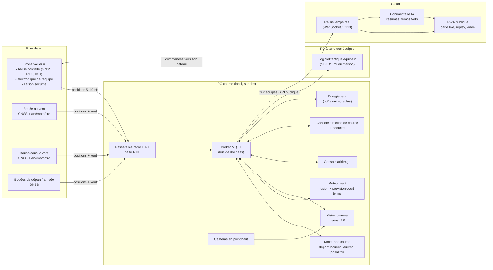

# AIregatta — Étude préalable
## Régate de voiliers drones, Toulon, mai 2027

> Version 0.1, 19 novembre 2026. Document de travail, à relire avec l'organisation et quelques compétiteurs.
> Les points marqués **[À VÉRIFIER]** sont des hypothèses techniques à confirmer avant toute décision.

> **Mise à jour du 19 novembre 2026 — décisions actées**
> - Le plan d'eau est choisi et validé : la partie réglementaire est retirée de cette étude.
> - Le PC course diffuse à toutes les équipes le vent, les positions des bouées et les positions de tous les bateaux.
> - Le format de course est défini, avec du près et du portant.
> - L'architecture des bateaux est libre pour l'instant.
> - Le logiciel sera développé en IA agentique (GSD) : les durées de développement sont révisées à la baisse.
>
> Les références de matériel et l'architecture des communications sont détaillées dans **[Matériel et communications](architecture-materiel-communications.md)**, qui prime sur cette étude en cas d'écart.

---

## Sommaire

1. [Synthèse](#1-synthèse)
2. [Ce que "digne de SailGP" veut dire ici](#2-ce-que-digne-de-sailgp-veut-dire-ici)
3. [Architecture d'ensemble](#3-architecture-densemble)
4. [Briques techniques et choix matériels](#4-briques-techniques-et-choix-matériels)
5. [Logiciels à développer](#5-logiciels-à-développer)
6. [Où l'IA apporte vraiment quelque chose](#6-où-lia-apporte-vraiment-quelque-chose)
7. [Sécurité sur l'eau](#7-sécurité-sur-leau)
8. [Budget indicatif](#8-budget-indicatif)
9. [Feuille de route (novembre 2026 → mai 2027)](#9-feuille-de-route-novembre-2026--mai-2027)
10. [Risques et parades](#10-risques-et-parades)
11. [Acheter ou construire](#11-acheter-ou-construire)
12. [Questions à trancher](#12-questions-à-trancher)
13. [Annexes](#13-annexes)

---

## 1. Synthèse

**Le projet est faisable pour mai 2027**, à condition de séparer clairement trois niveaux de difficulté :

| Brique | Faisabilité | Maturité technique | Commentaire |
|---|---|---|---|
| Positions des bateaux en temps réel (balise officielle) | Élevée | Éprouvée | GNSS RTK bas coût + 4G et/ou radio. Le cœur du système, à verrouiller en premier. |
| Positions des bouées | Élevée | Éprouvée | Même balise que les bateaux, posée sur la bouée. |
| PC course : moteur de course (départ, passages de bouées, arrivée, classement) | Élevée | Logiciel à écrire, logique connue | Gros morceau de développement, mais sans inconnue scientifique. |
| Diffusion des données aux PC à terre des concurrents (API) | Élevée | Éprouvée (MQTT / WebSocket) | Le vrai sujet est l'équité et le contrat d'interface, pas la technique. |
| Application publique PWA (carte live, classement, replay) | Élevée | Éprouvée | Peut viser un rendu très "broadcast" avec MapLibre + deck.gl / Three.js. |
| Mesure du vent sur les bouées | Bonne | Éprouvée, intégration délicate | Anémomètre ultrasonique + compas + compensation du mouvement de la bouée. |
| Champ de vent "fusionné" et prévision à 5–15 min | Moyenne | Statistique / ML classique | Fusion bouées + bateaux + station à terre + modèle AROME. Très utile, demande des tests réels. |
| Détection des risées par caméra | Expérimentale | Recherche appliquée | Possible en qualitatif depuis un point haut. À traiter comme un bonus avec solution de repli. |
| Assistance à l'arbitrage (OCS, zone de bouée, priorités) | Moyenne | Inspirée de SailGP | Détection automatique, décision humaine. Le RTK est indispensable. |
| Commentaire automatique par IA, réalité augmentée sur vidéo | Bonne / Moyenne | LLM : simple ; AR : calibration caméra | Gros effet "SailGP" pour le public. |

**Les recommandations structurantes :**

1. **Une balise officielle identique sur chaque bateau et chaque bouée**, fournie et scellée par l'organisation, indépendante de l'électronique des équipes. C'est ce qui garantit l'équité, le classement et l'arbitrage, comme les données "one-design" de SailGP.
2. **Le PC course tourne en local sur le site**, avec une copie dans le cloud pour le public. Si Internet tombe, la course continue.
3. **Un contrat d'interface publié tôt (janvier)**, avec un **simulateur** qui rejoue des courses : les équipes doivent pouvoir développer leurs logiciels tactiques dès l'hiver, sans attendre d'être sur l'eau.
4. **Une liaison de sécurité indépendante** (radiocommande classique ou coupe-circuit) sur chaque drone : indispensable pour la sécurité sur l'eau.
5. **L'IA sert là où elle a une vraie valeur** (vent, vision, arbitrage assisté, commentaire, analyse de performance). Le reste repose sur des algorithmes déterministes, plus fiables.
6. **Le chemin critique est le cycle matériel → essais sur l'eau → corrections**, plus que l'écriture du logiciel, qui sera accélérée par le développement agentique.

---

## 2. Ce que "digne de SailGP" veut dire ici

SailGP sert de modèle sur la façon de traiter la donnée, pas sur le budget. On en retient ce qu'on peut transposer :

| Chez SailGP | Transposition AIregatta |
|---|---|
| Bateaux monotypes, données centralisées et identiques pour tous | Balise officielle commune, données de course diffusées à l'identique à toutes les équipes |
| Positionnement très précis, limites de parcours virtuelles | GNSS RTK centimétrique, limites et ligne de départ virtuelles dans le moteur de course |
| Arbitrage électronique à distance (umpires à terre) | Console d'arbitrage avec détection automatique des situations, décision humaine |
| Graphismes en direct : vitesse, distance au leader, laylines, limites | Rendu live dans la PWA et incrustation sur la vidéo |
| Application et "Race Centre" pour les fans | PWA publique : carte 2D/3D live, classement, replay, vidéo, notifications |
| Équipes qui analysent leurs données de performance | Kit d'analyse fourni : polaires apprises, pertes aux virements, VMG |
| Caméras embarquées | Caméras FPV numériques légères sur les drones (option) |
| Production TV | Une ou deux caméras en point haut, streaming YouTube/Twitch intégré à la PWA, commentaire assisté par IA |

**Ce qu'on ne transpose pas** : l'infrastructure radio propriétaire, les centaines de capteurs par bateau, la régie TV complète. On vise **l'expérience** SailGP avec du matériel grand public.

---

## 3. Architecture d'ensemble



### 3.1 Les trois flux à distinguer

1. **Flux "officiel"** : balises → PC course. Il sert au classement et à l'arbitrage. Aucune équipe ne peut le modifier.
2. **Flux "équipes"** : PC course → PC à terre des équipes. Positions de tous les bateaux, bouées, vent, état de la course. Diffusé **à l'identique et en même temps** à tous.
3. **Flux "commande"** : PC à terre d'une équipe → son bateau. C'est le point d'architecture le plus important à trancher (voir 4.3 et questions C1–C4).

### 3.2 Budget de latence visé

| Étape | Cible | Commentaire |
|---|---|---|
| Mesure GNSS → réception au PC course | < 300 ms | 4G : 50–150 ms ; radio LoRa : 50–400 ms selon réglages |
| Traitement PC course → diffusion équipes | < 100 ms | Broker MQTT local |
| Décision logiciel équipe → bateau | < 500 ms | Dépend du canal de commande |
| **Boucle complète bateau → décision → bateau** | **< 1 s** | Suffisant pour la tactique. Le pilotage fin (barre) doit rester à bord. |
| PC course → public | 2–5 s | Un léger différé est acceptable et même souhaitable (anti-triche, lissage) |

**Conséquence de conception** : le pilotage bas niveau (tenir un cap, régler les voiles, exécuter un virement) **doit être embarqué**. La terre envoie des **consignes** ("virer maintenant", "cap au 245", "aller au waypoint X"), pas des coups de barre. C'est aussi ce qui rend le système robuste aux coupures radio.

---

## 4. Briques techniques et choix matériels

### 4.1 La balise officielle (bateaux et bouées)

Fonction : position, vitesse, cap, gîte, horodatage GNSS, état de santé (batterie, signal), transmission.

| Composant | Option recommandée | Prix indicatif | Alternative |
|---|---|---|---|
| Récepteur GNSS RTK multi-bandes | u-blox ZED-F9P (cartes ArduSimple simpleRTK2B, SparkFun) ou Unicore UM980 | 150–250 € | u-blox M10 (~20 €, précision 1–2 m, sans RTK) si la précision métrique suffit |
| Antenne GNSS multi-bandes | Antenne L1/L2 ou L1/L5 légère, étanche | 40–80 € | — |
| Cap / gîte / tangage | IMU BNO085 ou ICM-42688 + magnétomètre | 15–30 € | Double antenne GNSS (F9P + F9H) pour un cap fiable : +200 € et une base de 30 cm minimum |
| Microcontrôleur | ESP32-S3 | 10–20 € | Raspberry Pi Zero 2 W si on veut du calcul à bord |
| Radio | Voir 4.3 | 20–100 € | — |
| Modem 4G | LTE Cat-1 (SIMCom A7670 / SIM7600) | 25–50 € | LTE-M : moins cher en énergie mais latence plus élevée |
| Batterie + gestion | Li-ion 18650 × 2–4, autonomie 8 h visée | 20–30 € | — |
| Boîtier | IP67, fixation normalisée (2 vis + scellé) | 15–30 € | Impression 3D PETG/ASA + joint |
| Enregistrement local | Carte microSD, toutes les données à 10 Hz | 5 € | — |
| **Total par balise** | | **≈ 300–550 € (RTK)** / **≈ 80–150 € (non RTK)** | |

**Faut-il du RTK ?** Probablement oui, dès que les bateaux font moins de 2 m et qu'on veut détecter automatiquement les départs anticipés (OCS) ou les engagements en zone de bouée. Un GNSS standard se trompe de 1 à 3 m, soit l'équivalent de la longueur d'un bateau. Le RTK descend à 2–5 cm.

**Correction RTK** : une **base RTK à terre** (F9P + antenne géodésique fixe, environ 400 €) diffuse ses corrections (RTCM, environ 1 kbit/s) par la radio ou par 4G via un petit caster NTRIP local. Le réseau collaboratif gratuit **Centipede** peut servir de secours **[À VÉRIFIER : base Centipede la plus proche de la rade]**.

**Horodatage** : toutes les mesures sont horodatées en temps GNSS (PPS). Le serveur du PC course se synchronise sur un récepteur GNSS. Personne ne discute l'ordre des événements.

### 4.2 Bouées instrumentées

| Composant | Option recommandée | Prix indicatif |
|---|---|---|
| Balise officielle (4.1) | identique aux bateaux | 300–550 € |
| Anémomètre | Ultrasonique (Calypso Ultrasonic Portable/Wired, ou Gill WindSonic) | 400–1 000 € |
| Compas / IMU | Indispensable : la bouée tourne sur son mouillage | inclus ou 30 € |
| Énergie | Panneau solaire 10–20 W + batterie LiFePO4 | 80–150 € |
| Mât + flotteur | Bouée gonflable de régate + espar porte-capteur à 1,5–2 m | 150–400 € |
| **Total par bouée instrumentée** | | **≈ 1 000–2 000 €** |

**Points d'attention :**
- **Mouvement de la bouée** : roulis et tangage faussent la mesure. On corrige avec l'IMU et on moyenne sur 5–10 s. Une bouée de type espar, lestée, bouge beaucoup moins qu'une bouée gonflable.
- **Évitage sur le mouillage** : la bouée se déplace de quelques mètres. Sa position GNSS doit être diffusée en continu, pas seulement au mouillage.
- **Hauteur de mesure** : à 2 m au-dessus de l'eau, la mesure est proche de ce que "sent" un petit drone. C'est un avantage.

**Option ambitieuse : bouées robotisées**, qui tiennent leur position par GNSS avec deux propulseurs (ArduPilot Rover en mode "loiter"), sur le principe des MarkSetBot. La direction de course peut **déplacer la bouée au vent depuis la console** quand le vent tourne : c'est très "SailGP", et cela fait gagner beaucoup de temps entre deux manches. Coût en fabrication maison : 1 500–3 000 € par bouée. À réserver à une phase 2 si le planning le permet.

### 4.3 Communications : le choix le plus structurant

Trois besoins différents, qui peuvent utiliser des canaux différents :

| Besoin | Débit | Criticité |
|---|---|---|
| Positions officielles (bateaux + bouées → PC course) | 0,5–4 kbit/s par bateau | Critique (classement) |
| Commandes équipes (terre → bateau) | Faible | Critique pour les équipes |
| Sécurité (arrêt d'urgence, reprise en main) | Très faible | Vitale |
| Vidéo embarquée (option) | 2–10 Mbit/s par bateau | Confort |

**Options comparées :**

| Technologie | Avantages | Limites | Coût |
|---|---|---|---|
| **4G/LTE (SIM IoT)** | Simple, débit élevé, couverture correcte en rade, zéro infrastructure | Dépend des opérateurs, risque de saturation si foule, latence variable | 25–50 €/modem + 2–5 €/mois/SIM |
| **LoRa 868 MHz** | Portée excellente, très basse consommation | Débit faible ; **rapport cyclique réglementé** (1 % ; 10 % et 500 mW dans la sous-bande 869,4–869,65 MHz) ; demande un multiplexage temporel calé sur le temps GNSS | 15–30 €/module |
| **LoRa 2,4 GHz (SX1280, technologie ExpressLRS)** | Pas de contrainte de rapport cyclique, débit plus élevé, éprouvé en radiocommande avec télémétrie | Portée moindre qu'en 868 ; bande 2,4 GHz encombrée (téléphones et radiocommandes du public) | 20–40 €/module |
| **Wi-Fi longue portée (5 GHz, point-multipoint)** | Gros débit (vidéo) | Antenne basse sur un bateau qui gîte : liaison instable au-delà de quelques centaines de mètres | 80–150 €/bateau + station à terre |
| **Radios de télémétrie (SiK, RFD868)** | Standard ArduPilot / MAVLink, maillage possible | Débit moyen, coût plus élevé pour les modèles robustes | 50–300 €/module |

**Recommandation : double chemin + liaison de sécurité séparée**

- **Chemin principal** : 4G (simple, gros débit, permet le 10 Hz).
- **Chemin de secours** : radio privée (LoRa 868 en sous-bande 10 % ou LoRa 2,4 GHz) à 1–2 Hz, en multiplexage temporel sur le temps GNSS. Si la 4G tombe, le classement continue.
- **Liaison de sécurité** : radiocommande classique ou coupe-circuit dédié, tenue par l'équipe ou par un officier sécurité. Elle est indépendante de tout le reste.
- **Campagne de mesure en janvier** : couverture 4G et portée radio réelles sur le plan d'eau choisi, avec 2 balises prototypes. C'est cette mesure qui fixera le choix définitif.

**Portée théorique** : avec une antenne à 0,5 m sur le bateau et une antenne à 20 m à terre, l'horizon radio est d'environ 18 km. La distance n'est pas le problème ; les réflexions sur l'eau et la gîte le sont. Il faut une antenne à terre **en hauteur** (toit, mât télescopique de 10 m).

**Plan de fréquences** : avec 10 à 20 équipes qui apportent chacune leurs radios, il faut **un plan de fréquences imposé par l'organisation** (canaux attribués, puissances maximales), déclaré dans les instructions de course. Point sensible à proximité d'une base navale **[À VÉRIFIER avec l'ANFR et la Marine]**.

### 4.4 Capteurs de vent complémentaires

Le champ de vent se construit en croisant plusieurs sources :

| Source | Ce qu'elle apporte | Coût |
|---|---|---|
| Bouées instrumentées (2 à 4) | Vent réel ponctuel, précis, en continu | voir 4.2 |
| **Les bateaux eux-mêmes** | Si les drones ont une girouette en tête de mât, chaque bateau devient un capteur mobile. On calcule le vent réel à partir du vent apparent et de la vitesse/du cap GNSS. | 0 € si déjà à bord ; sinon une girouette magnétique à 20–50 € |
| Station météo à terre en point haut | Tendance générale, rafales | 200–800 € |
| Modèles Météo-France (AROME 1,3 km, AROME-PI en prévision immédiate) | Tendance à l'échelle de l'heure, brise thermique | Gratuit (données publiques) |
| Caméras (4.5) | Risées visibles à la surface de l'eau | voir 4.5 |

**Contexte local en mai [À VÉRIFIER avec des régatiers toulonnais]** : brise thermique de secteur sud à sud-est l'après-midi, épisodes de mistral (nord-ouest) parfois forts, effets de site marqués (Faron, Cap Sicié, Saint-Mandrier, presqu'île de Giens). Les variations locales seront importantes : c'est exactement ce qui rend l'analyse du vent intéressante pour les équipes.

### 4.5 Caméras en point haut

Deux usages, qui peuvent partager le même matériel :

**A. Spectacle (vidéo live + réalité augmentée)**
- Caméra 4K fixe (200–500 €) ou PTZ ONVIF qui donne son orientation (pan/tilt/zoom, 800–2 000 €).
- On calibre la caméra (position, orientation, focale) en utilisant les bouées comme points de repère, puisque leurs positions GNSS sont connues.
- On peut alors **incruster sur la vidéo** les noms des bateaux, la ligne de départ, les laylines, les limites du parcours, comme à la télévision.
- Diffusion vers YouTube Live, intégrée dans la PWA.

**B. Analyse des risées (expérimental)**
- Principe : une risée ride la surface ; l'eau paraît plus sombre (moins de reflet du ciel). Depuis un point haut, on voit ces zones avancer.
- Chaîne de traitement : redressement de l'image en vue de dessus (homographie calée sur les bouées) → soustraction d'un fond moyen → segmentation des zones sombres → suivi par flux optique → vitesse et direction de déplacement des risées → carte superposée à la course.
- **Conditions** : point de vue à **20 m minimum** (idéalement 40 m et plus), filtre polarisant, soleil pas face à la caméra. Le résultat sera qualitatif ("une risée arrive par la droite du parcours dans 1 à 2 minutes"), pas une mesure en nœuds.
- **Points hauts possibles [À VÉRIFIER]** : fort ou bâtiment du littoral, immeuble en front de mer, mât télescopique sur un véhicule, phare.
- **Drone aérien** : très attractif mais **fortement contraint** en rade de Toulon (zones militaires, proximité de l'aérodrome de Hyères). Ne pas en faire une dépendance.

### 4.6 Caméras embarquées (option "SailGP")

- Caméras FPV numériques légères (types Walksnail / DJI O3 / HDZero) : 100–250 € par bateau, quelques km de portée en vue directe.
- Le PC course choisit le flux embarqué à montrer, comme en réalisation TV.
- Contrainte : poids (30–60 g) et consommation, à valider selon la taille des drones. Bande 5,8 GHz à intégrer au plan de fréquences.

### 4.7 Électronique embarquée des équipes : proposer un "kit de référence"

Pour que des équipes moins équipées puissent participer, l'organisation peut proposer un kit optionnel :

- **Contrôleur ArduPilot Rover**, qui gère nativement les voiliers : girouette, réglage de grand-voile, virements automatiques, navigation par waypoints, communication MAVLink. Contrôleurs de type Matek H743 (80–120 €) ou Pixhawk 6C (200 €).
- **Pont MAVLink ↔ API de course** fourni par l'organisation : le logiciel de l'équipe envoie "va au waypoint" ou "vire", ArduPilot exécute.
- Les équipes avancées restent libres de leur électronique.

---

## 5. Logiciels à développer

### 5.1 Vue d'ensemble des modules

| # | Module | Utilisateurs | Priorité | Effort estimé (jours-personne) |
|---|---|---|---|---|
| L1 | Firmware balise officielle (ESP32 : GNSS, IMU, 4G, radio, carte SD) | Organisation | Indispensable | 15–25 |
| L2 | Passerelles (radio → MQTT, caster NTRIP local) | Organisation | Indispensable | 5–10 |
| L3 | Bus de données + modèle de données + enregistreur (boîte noire) | Tous | Indispensable | 8–12 |
| L4 | **Moteur de course** (machine à états : procédure de départ, OCS, passages de bouées, arrivée, pénalités, classement) | Organisation | Indispensable | 20–30 |
| L5 | Console direction de course (parcours, séquence de départ, sécurité, santé des balises) | Organisation | Indispensable | 15–20 |
| L6 | **API publique équipes + SDK Python/JS + documentation** | Équipes | Indispensable | 8–12 |
| L7 | **Simulateur de régate** (rejoue ou génère des courses avec le même protocole) | Équipes, organisation | Indispensable | 10–15 |
| L8 | PWA publique : carte live 2D/3D, classement, fiche bateau, replay, vidéo | Public | Indispensable | 25–40 |
| L9 | Moteur vent : fusion des sources, carte de vent, tendances, prévision à 5–15 min | Équipes, public | Important | 15–25 |
| L10 | Console d'arbitrage assisté (alertes, rejeu instantané, décision) | Arbitres | Important | 10–15 |
| L11 | Kit tactique de référence pour équipes (laylines, VMG, polaires apprises, passages, routage court) | Équipes | Important | 10–20 |
| L12 | Commentaire IA et temps forts automatiques (FR/EN) | Public | Bonus fort | 5–10 |
| L13 | Incrustation AR sur la vidéo | Public | Bonus fort | 10–20 |
| L14 | Analyse des risées par caméra | Équipes, public | Expérimental | 15–30 |
| L15 | Analyse post-course (rapports par équipe, polaires, pertes aux manœuvres) | Équipes | Bonus | 5–10 |
| | **Total MVP (L1–L8)** | | | **≈ 105–165 j** |
| | **Total complet** | | | **≈ 180–310 j** |

> **Révisé** : ces durées supposent un développement classique. En IA agentique (GSD), le logiciel pur se réduit à quelques semaines ; le calendrier est alors fixé par le matériel et les essais sur l'eau. Voir la section 11 de [Matériel et communications](architecture-materiel-communications.md#11-développement-en-ia-agentique--ce-qui-change).

### 5.2 Choix techniques proposés

| Couche | Choix | Pourquoi |
|---|---|---|
| Bus de données | **MQTT** (Mosquitto ou EMQX) en local | Standard IoT, léger, gère l'abonnement par sujet, les équipes savent s'en servir |
| Modèle de données | JSON aligné sur le vocabulaire **Signal K** (standard ouvert de données marines), Protobuf pour la radio | Les équipes ne réinventent rien, et des outils existent déjà (Signal K, OpenCPN) |
| Moteur de course, vent | Python (asyncio, numpy, scipy) ou TypeScript/Node | Python pour la partie scientifique ; à choisir selon l'équipe de développement |
| Base de données | PostgreSQL + TimescaleDB, ou simple journal de fichiers + Parquet | Séries temporelles, replay |
| Relais public | WebSocket derrière un CDN (Cloudflare, Fly.io, ou serveur dédié) | Le PC course n'envoie qu'un flux ; le cloud redistribue à des milliers de spectateurs |
| PWA | React ou Svelte + **MapLibre GL** + **deck.gl** (ou Three.js pour la 3D) | Open source, sans licence par utilisateur, très bon rendu |
| Vision | OpenCV + Python, GPU optionnel | Classique et maîtrisé |
| IA générative | API LLM (ex. Claude) pour le commentaire et les résumés | Peu de code, gros effet |

### 5.3 Contrat d'interface (exemple)

Sujets MQTT :

```
race/{raceId}/state                  # état de la course (séquence, chrono, manche)
race/{raceId}/course                 # parcours : bouées, portes, ligne, limites
race/{raceId}/marks/{markId}         # position + vent mesuré
race/{raceId}/boats/{boatId}/pos     # position officielle (5–10 Hz)
race/{raceId}/wind/field             # carte de vent fusionnée (1 Hz)
race/{raceId}/wind/forecast          # tendance à 5–15 min
race/{raceId}/events                 # départ, OCS, passage bouée, pénalité, arrivée
race/{raceId}/leaderboard            # classement live
team/{teamId}/cmd                    # (si commandes via l'organisation) consignes vers son bateau
team/{teamId}/telemetry              # (option) télémétrie privée de l'équipe
```

Message de position (exemple) :

```json
{
  "boatId": "FRA-07",
  "t": "2027-05-15T13:42:07.200Z",
  "lat": 43.10512345,
  "lon": 5.93876543,
  "fix": "rtk_fixed",
  "sog": 3.42,
  "cog": 247.1,
  "heading": 251.0,
  "heel": 14.2,
  "src": "4g",
  "batt": 0.81
}
```

Événement d'arbitrage (exemple) :

```json
{
  "type": "OCS",
  "t": "2027-05-15T13:40:00.000Z",
  "boatId": "FRA-03",
  "distanceOverLine_m": 0.42,
  "confidence": 0.97,
  "status": "pending_umpire"
}
```

**Règle d'or** : le contrat d'interface est **gelé mi-mars**. Au-delà, seuls des ajouts compatibles sont autorisés.

### 5.4 Le moteur de course en détail

Le moteur est une **machine à états** par bateau et par course :

- **Pré-départ** : séquence de départ synchronisée sur le temps GNSS (signal sonore, affichage, notification aux équipes). Calcul en continu de la distance à la ligne, du temps pour l'atteindre, et du côté de la ligne.
- **Départ** : détection OCS au centimètre près (RTK), avec un intervalle de confiance. Liste des rappels individuels transmise aux arbitres et aux équipes en moins d'une seconde.
- **Passages de bouée** : détection du contournement dans le bon sens (secteur angulaire + côté de passage), temps de passage, écarts.
- **Zone de bouée** (4 longueurs en radiocommande, annexe E des RCV **[À VÉRIFIER selon les règles retenues]**) : entrée en zone, engagements, alerte en cas de situation litigieuse.
- **Limites du parcours virtuelles** : alerte de sortie, pénalité possible, comme en SailGP.
- **Arrivée et classement** : temps d'arrivée, classement provisoire immédiat, classement définitif après arbitrage.
- **Mode dégradé** : si une balise ne transmet plus, le moteur le signale, interpole sur quelques secondes, puis gèle l'état du bateau. On récupère les données de la carte SD après la course pour confirmer.

### 5.5 Outils pour les équipes

L'organisation fournit :

1. **L'API** (flux temps réel identique pour tous).
2. **Un SDK** Python et JavaScript : connexion, décodage, géométrie de base (distances, relèvements, laylines).
3. **Le simulateur** : rejoue des courses enregistrées, ou génère des courses avec un vent synthétique réaliste (bascules, risées). C'est indispensable pour que les équipes développent dès janvier.
4. **Un tableau de bord tactique de référence**, open source, que les équipes peuvent reprendre et améliorer : laylines, VMG, polaire apprise en direct, bascules de vent, prochain virement optimal, croisements avec les adversaires.
5. **Les données de toutes les courses après l'événement**, pour l'analyse.

Ce qui reste du ressort des équipes : la stratégie, la tactique, le pilotage, leur propre IA.

### 5.6 La PWA publique

| Fonction | Priorité |
|---|---|
| Carte live (2D, rendu "broadcast" sombre, traces, noms) | Indispensable |
| Classement live, écarts au leader en temps et en distance | Indispensable |
| Compte à rebours, statut de la course, résultats | Indispensable |
| Vidéo live intégrée | Indispensable si caméra |
| Replay avec curseur de temps | Indispensable |
| Fiches équipes et bateaux | Important |
| Vent : flèches, carte de vent, risées | Important |
| Laylines, ligne de départ, limites, zones de bouée affichées | Important |
| Vue 3D façon SailGP (caméra qui suit un bateau) | Bonus fort |
| Commentaire texte IA en direct, FR/EN | Bonus fort |
| Notifications push (départ, passage en tête, arrivée) | Bonus |
| Mode "grand écran" pour le village et les écrans du PC course | Important |
| Pronostics / jeu pour le public | Bonus |
| Fonctionnement hors ligne (programme, résultats) | Important (réseau saturé sur la plage) |

---

## 6. Où l'IA apporte vraiment quelque chose

Un algorithme simple et prévisible est préférable à de l'IA partout où il suffit : le classement, la détection de passage de bouée et le calcul d'une layline ne demandent pas d'IA. L'IA est utile pour ce qui suit :

| Usage | Technique | Valeur | Risque |
|---|---|---|---|
| **Champ de vent et prévision à 5–15 min** | Fusion par filtre de Kalman / processus gaussiens, puis modèle appris sur les données des journées d'essai | Très forte pour les équipes et le spectacle ("bascule à droite dans 3 min") | Faible si présenté comme une tendance avec un niveau de confiance |
| **Polaires apprises** | Régression sur les données de vitesse de chaque bateau (vent réel, angle, vitesse) | Forte pour les équipes | Faible |
| **Détection des risées par vision** | Vision classique + éventuellement un petit réseau de segmentation entraîné sur les images d'essai | Forte pour le spectacle | Élevé (dépend de la lumière) → bonus |
| **Arbitrage assisté** | Règles géométriques + score de confiance + rejeu automatique | Forte (vitesse de décision) | La décision reste humaine |
| **Commentaire et temps forts** | LLM alimenté par les événements structurés du moteur de course | Très forte pour le public, peu coûteuse | Hallucination → le LLM ne reçoit **que** des faits structurés et ne peut rien inventer |
| **Réalisation automatique** | Choix de la caméra / du bateau à suivre selon l'intérêt de la situation (écarts serrés, croisement) | Moyenne | Faible |
| **Détection d'anomalies** | Balise qui dérive, batterie, perte de RTK, bateau immobile (chavirage ?) | Forte pour la sécurité | Faible |
| **Assistant tactique des équipes** | Laissé aux équipes ; le kit de référence propose une base | Forte | Responsabilité des équipes |

---

## 7. Sécurité sur l'eau

> Le plan d'eau est validé ; les démarches réglementaires ne sont pas traitées ici.

- **Bateau(x) de sécurité** à moteur avec le matériel pour récupérer un drone.
- **Coupe-circuit / reprise en main** obligatoire sur chaque drone, testé au contrôle d'équipement.
- **Comportement en cas de perte de liaison** imposé par les règles : après N secondes sans liaison, le drone se met face au vent ou choque ses voiles et attend (option : il revient vers un point de repli).
- **Barrière virtuelle (geofence)** imposée par le firmware ou surveillée par le PC course, avec alerte immédiate.
- **Feux et visibilité** : couleurs vives, pavillon d'identification, numéro lisible.
- **Contrôle d'équipement** la veille : balise, sécurité, fréquences, batteries.

---

## 8. Budget indicatif

Hypothèse de calcul : **12 bateaux, 4 bouées dont 2 instrumentées en vent**, 1 journée d'essais grandeur nature + 2 jours de course. Prix publics TTC, ordres de grandeur.

### 8.1 Matériel

| Poste | Scénario "Essentiel" | Scénario "SailGP" |
|---|---|---|
| Balises officielles bateaux (12 + 3 de rechange) | 15 × 400 € = **6 000 €** | idem |
| Balises bouées non instrumentées (2) | **800 €** | idem |
| Bouées instrumentées vent (2) | 2 × 1 400 € = **2 800 €** | 4 × 1 600 € = **6 400 €** |
| Bouées robotisées | — | 3 × 2 500 € = **7 500 €** |
| Base RTK + passerelles radio + antennes en hauteur | **1 200 €** | **2 000 €** |
| Réseau PC course (routeur 4G/5G de secours, switch, onduleur) | **800 €** | **1 500 €** |
| Station météo à terre | **300 €** | **800 €** |
| Caméras en point haut | 1 caméra 4K fixe : **400 €** | 2 PTZ + 1 fixe : **4 000 €** |
| Mât télescopique 10–12 m (si besoin) | **400 €** | **400 €** |
| Caméras FPV embarquées | — | 12 × 200 € + récepteurs = **3 000 €** |
| PC course (1 serveur + 2 postes) | **2 500 €** (ou matériel existant) | **4 000 €** |
| Écrans pour le public (location) | — | **2 000–5 000 €** |
| Prototypes, casse, imprévus (≈ 15 %) | **2 300 €** | **6 000 €** |
| **Total matériel** | **≈ 17 500 €** | **≈ 45 000–48 000 €** |

### 8.2 Fonctionnement

| Poste | Estimation |
|---|---|
| SIM IoT (15 × 6 mois) | 300–500 € |
| Hébergement cloud (relais temps réel, PWA, stockage replay) | 30–150 €/mois ; pic pendant l'événement |
| Streaming vidéo | gratuit via YouTube Live |
| API LLM pour le commentaire | < 100 € sur l'événement |
| Domaine, notifications push | < 100 € |

### 8.3 Développement logiciel

Le développement étant mené en IA agentique, le coût se résume essentiellement au temps des personnes qui pilotent les agents (quelques semaines à 1–2 personnes) et aux abonnements des outils d'IA. L'estimation en prestation classique est abandonnée.

Pistes pour réduire la facture : développement interne ou en partenariat avec une école d'ingénieurs (ISEN Toulon, SeaTech / Université de Toulon) **[À VÉRIFIER]**, mécénat technologique, réutilisation de briques open source (voir section 11), et **publication du logiciel en open source** pour attirer contributeurs et sponsors.

**Sources de financement à explorer** : Région Sud, Métropole TPM, pôle Mer Méditerranée, industriels de la défense et du naval très présents à Toulon (intérêt direct pour les drones de surface), sponsors technologiques.

---

## 9. Feuille de route (novembre 2026 → mai 2027)

```mermaid
gantt
  title AIregatta — plan de marche
  dateFormat YYYY-MM-DD
  axisFormat %b
  section Cadrage
  Décisions structurantes (questions §12)      :a1, 2026-11-20, 25d
  Recherche financement / partenaires           :a3, 2026-12-01, 90d
  section Matériel
  Commande échantillons (GNSS, radios, anémo)   :b1, 2026-12-01, 20d
  Prototype balise v1 + base RTK                :b2, after b1, 25d
  Campagne de mesure radio/4G sur l'eau         :crit, b3, 2027-01-15, 10d
  Balise v2 + série (15 unités)                 :b4, 2027-02-01, 35d
  Bouées instrumentées                          :b5, 2027-02-01, 45d
  Caméras + point haut                          :b6, 2027-03-01, 30d
  section Logiciel
  Modèle de données + API v0 publiée            :crit, c1, 2026-12-15, 25d
  Simulateur + SDK pour les équipes             :c2, 2027-01-05, 30d
  Moteur de course                              :c3, 2027-01-10, 60d
  Console direction de course                   :c4, 2027-02-01, 45d
  PWA publique v1                               :c5, 2027-02-01, 50d
  Gel du contrat d'interface                    :milestone, m1, 2027-03-15, 0d
  Vent fusionné + prévision                     :c6, 2027-02-15, 50d
  Arbitrage assisté                             :c7, 2027-03-01, 35d
  Bonus : AR, risées, commentaire IA            :c8, 2027-03-01, 50d
  section Essais
  Essai sur l'eau n°1 (2 balises)               :d1, 2027-01-20, 2d
  Essai n°2 (bouées + 4 bateaux + PC course)    :d2, 2027-03-10, 2d
  Régate blanche avec les équipes               :crit, d3, 2027-04-10, 2d
  Répétition générale                           :crit, d4, 2027-04-30, 2d
  section Événement
  Régate                                        :crit, e1, 2027-05-15, 3d
  Replays, rapports, retour d'expérience        :e2, after e1, 20d
```

*Les dates de la régate sont à fixer ; le plan est calé sur mi-mai.*

### Jalons et critères de passage

| Jalon | Date cible | Critère "go" |
|---|---|---|
| J1 — Cadrage validé | mi-décembre 2026 | Questions restantes tranchées (voir [Matériel et communications §12](architecture-materiel-communications.md#12-questions-restantes)) ; matériel prototype commandé |
| J2 — Balise validée sur l'eau | fin janvier 2027 | 2 balises en RTK fixe > 95 % du temps, liaison > 99 % des paquets à la distance maximale du parcours |
| J3 — API gelée | 15 mars 2027 | Simulateur utilisé par au moins 3 équipes ; aucune demande de modification majeure en attente |
| J4 — Régate blanche | mi-avril 2027 | Course complète menée de bout en bout, classement automatique juste, PWA tenue en charge (test à 5 000 connexions simulées) |
| J5 — Répétition générale | fin avril 2027 | Tous les modes dégradés testés (coupure 4G, coupure Internet, balise morte, PC course redémarré) |

---

## 10. Risques et parades

| Risque | Probabilité | Impact | Parade |
|---|---|---|---|
| Liaison radio/4G instable sur l'eau | Moyenne | Élevé | Double chemin, campagne de mesure en janvier, carte SD dans chaque balise |
| Saturation 4G le jour J (public sur la plage) | Moyenne | Moyen | Radio privée de secours ; SIM sur deux opérateurs ; liaison filaire ou 5G pour le PC course |
| Interférences entre radios des équipes | Moyenne | Élevé | Plan de fréquences imposé, contrôlé à l'inscription |
| Perte du RTK (masque, multitrajets) | Faible | Moyen | Mode dégradé : précision métrique + marges de confiance pour l'arbitrage |
| Vent nul ou trop fort | Moyenne | Élevé | Fenêtre de plusieurs jours ; limites de vent écrites dans les instructions de course ; animation de la PWA avec les replays |
| Détection des risées décevante | Élevée | Faible | C'est un bonus ; la carte de vent repose d'abord sur les bouées et les bateaux |
| Retard logiciel | Moyenne | Élevé | Priorisation stricte (MVP d'abord) ; gel de l'API ; régate blanche obligatoire |
| Équipes pas prêtes (logiciel) | Moyenne | Moyen | Simulateur tôt, kit de référence ArduPilot, sessions d'accompagnement |
| Contestation d'un classement automatique | Faible | Moyen | Décision humaine, rejeu disponible, données brutes conservées |
| Collision drone / autre navire | Faible | Très élevé | Zone balisée, bateaux de sécurité, coupe-circuit, geofence |
| Panne électrique au PC course | Faible | Élevé | Onduleur, groupe ou batteries, deuxième machine prête à reprendre |

---

## 11. Acheter ou construire

| Solution existante | Ce qu'elle fait | Intérêt pour nous |
|---|---|---|
| **TracTrac**, **Kwindoo**, **Igtimi YachtBot** | Suivi de flotte et visualisation pour les régates | Rapide à déployer, mais peu ouvert aux drones et à une API temps réel pour les équipes ; licence. Peut servir de **plan B public**. |
| **SAP Sailing Analytics** | Analyse de régate, passée en open source **[À VÉRIFIER]** | À étudier : réutiliser le modèle de course ou des algorithmes |
| **Vakaros (Atlas / RaceSense)** | Instruments de départ et suivi de flotte | Référence pour l'arbitrage électronique ; coûteux et pensé pour des bateaux habités |
| **ArduPilot Rover (mode voilier)** | Pilote automatique open source de voilier | **À réutiliser** pour le kit de référence |
| **Signal K** | Standard et serveur ouverts de données marines | **À réutiliser** pour le modèle de données |
| **MapLibre / deck.gl / Three.js** | Cartographie et 3D web | **À réutiliser** pour la PWA |
| **Météo-France (données publiques)** | AROME, AROME-PI | **À intégrer** au moteur vent |
| **Centipede RTK** | Réseau gratuit de bases RTK | Secours RTK |

**Recommandation** : construire le cœur (balise, moteur de course, API, PWA), parce que c'est ce qui rend l'événement unique et réutilisable pour les éditions suivantes. Réutiliser l'open source partout où c'est possible. Garder une solution commerciale de suivi en tête comme plan B pour l'affichage public uniquement.

---

## 12. Questions à trancher

Les questions sont classées par bloc. Celles marquées ★ conditionnent l'architecture et sont à trancher **en premier** (avant mi-décembre).

> **Tranchées le 19 novembre 2026** : B2 (format défini, près et portant), D1 (toutes les équipes reçoivent vent, bouées et positions de tous les bateaux), E1 et la partie réglementaire (plan d'eau validé), A1 et A4 provisoirement (architecture des bateaux libre).

### A. Les bateaux et les équipes
- **A1 ★** Quel type de voiliers drones : taille (longueur, poids), monotype ou open, catégorie existante (IOM, RC Laser, Microtransat, World Robotic Sailing Championship) ou nouvelle classe ?
- **A2 ★** Quel niveau d'autonomie : bateau entièrement autonome, consignes depuis la terre (ce que décrit le brief), pilotage humain possible ou interdit ? Un humain peut-il reprendre la main pendant la course ?
- **A3 ★** Combien de bateaux attendus (fourchette basse et haute) ? Combien d'équipes, de quel profil (écoles, universités, industriels, clubs, particuliers) ?
- **A4** Les bateaux ont-ils déjà une électronique (girouette, GPS, autopilote) ? Est-ce imposé, libre, fourni ?
- **A5** Faut-il proposer un kit de référence (ArduPilot + pont API) pour élargir la participation ?
- **A6** Vitesse attendue des bateaux et durée d'une manche ? Combien de manches par jour ?

### B. Règles de course et format
- **B1 ★** Sur quelles règles s'appuyer : RCV + annexe E (radiocommande), règles du World Robotic Sailing Championship, règles maison ?
- **B2** Format : parcours banane (au vent / sous le vent), triangle, match race, course en flotte, épreuves de précision (station-keeping, navigation à l'aveugle) ?
- **B3** Limites de parcours virtuelles comme en SailGP ? Avec quelles pénalités ?
- **B4** Arbitrage : sur l'eau, à terre sur écran, mixte ? Qui sont les arbitres ?
- **B5** Classement : temps réel, points par manche, général ? Cadre fédéral (FFV) ou non ?

### C. Communications et commande des bateaux
- **C1 ★** Les commandes des équipes vers leur bateau passent-elles **par l'infrastructure de l'organisation** (équité, contrôle, moins d'interférences) ou **par les moyens propres de chaque équipe** ?
- **C2 ★** Accepte-t-on la 4G comme chemin principal, ou exige-t-on un réseau 100 % privé (indépendance vis-à-vis des opérateurs) ?
- **C3** Qui tient la liaison de sécurité : l'équipe, un officier sécurité de l'organisation, les deux ?
- **C4** Que doit faire un drone quand il perd la liaison ?
- **C5** Les équipes peuvent-elles embarquer leurs propres capteurs et leur propre calcul (IA embarquée) ? Faut-il plafonner quelque chose (capteurs, communications, puissance de calcul) ?

### D. Données et équité
- **D1 ★** Quelles données reçoivent les équipes : uniquement leur bateau ? toute la flotte ? les bouées et le vent ? avec quel différé ? (SailGP partage beaucoup ; en régate classique on voit les adversaires à l'œil.)
- **D2** Une équipe peut-elle utiliser des sources externes (modèles météo, ses propres capteurs à terre, ses propres caméras) ?
- **D3** Les données de télémétrie privées d'une équipe (réglages, électronique) restent-elles privées ? Sont-elles publiées après la course ?
- **D4** Les données de course sont-elles publiées en open data après l'événement ?
- **D5** Quel différé pour le public (2 s, 10 s, 30 s) afin d'éviter que des équipes utilisent la PWA comme source "pirate" ?

### E. Plan d'eau et réglementation
- **E1 ★** Quel plan d'eau précis ? Est-il déjà identifié ou pré-discuté avec la Préfecture maritime / la capitainerie ?
- **E2 ★** Qui porte juridiquement l'événement (association, club, collectivité, entreprise) ? Y a-t-il un club support (Yacht Club de Toulon, COYT, autre) ?
- **E3** Dates exactes et jours de réserve en cas de météo défavorable ?
- **E4** Quel point haut est accessible pour les caméras et les antennes ? Y a-t-il de l'électricité et un accès Internet filaire sur place ?
- **E5** Quels moyens nautiques de sécurité sont disponibles (semi-rigides, pilotes) ?

### F. Public et diffusion
- **F1** Quel public : spectateurs sur place, en ligne, scolaires, partenaires, médias ? Quelle audience vise-t-on (quelques centaines ou plusieurs milliers de connexions simultanées) ?
- **F2** Faut-il une production vidéo avec commentateur humain, ou le commentaire IA suffit-il ?
- **F3** Écrans géants sur place ? Village ?
- **F4** Langues : français seul ou français + anglais ?
- **F5** Identité visuelle et marque de l'événement : existe-t-elle ? Les sponsors doivent-ils apparaître dans la PWA ?
- **F6** La PWA doit-elle servir après l'événement (replays, éditions suivantes, autres régates) ?

### G. IA : jusqu'où aller
- **G1** Quelles fonctions IA sont prioritaires parmi : prévision de vent, risées par caméra, arbitrage assisté, commentaire automatique, réalisation automatique, analyse de performance ?
- **G2** L'organisation fournit-elle un "assistant tactique" de base aux équipes, ou est-ce le cœur de la compétition laissé aux équipes ? (Si c'est une compétition d'IA, il faut sans doute **ne pas** le fournir.)
- **G3** Accepte-t-on une IA dans la boucle d'arbitrage (en aide uniquement), et comment l'annoncer aux équipes ?

### H. Budget, équipe, calendrier
- **H1 ★** Quelle enveloppe budgétaire (matériel, développement, fonctionnement) ? Scénario "Essentiel" ou "SailGP" ?
- **H2 ★** Qui développe : équipe interne, prestataire, école partenaire, communauté open source ? Combien de personnes à partir de quand ?
- **H3** Le matériel embarqué officiel est-il prêté aux équipes, vendu, ou fabriqué par elles selon un cahier des charges ?
- **H4** Le logiciel est-il open source ?
- **H5** Le projet doit-il durer au-delà de mai 2027 (circuit, plusieurs étapes, autres villes) ? Cela change la façon d'investir.
- **H6** Partenaires industriels ou institutionnels déjà approchés (Marine, industriels du naval et de la défense, pôle Mer, université) ?

---

## 13. Annexes

### 13.1 Ordres de grandeur utiles

- **Débit position** : 40 octets × 10 Hz = 3,2 kbit/s par bateau ; 15 bateaux ≈ 50 kbit/s. Trivial en 4G, impossible en LoRa 868 à ce rythme (d'où 1–2 Hz en secours).
- **LoRa 868** : un paquet de 30 octets en SF7 / 125 kHz dure environ 50–60 ms. À 1 Hz, cela fait environ 6 % de temps d'émission : au-dessus de la limite de 1 %, mais compatible avec la sous-bande 869,4–869,65 MHz (10 %).
- **Précision** : GNSS standard 1–3 m ; RTK 2–5 cm ; un bateau d'un mètre parcourt environ 1,5 m/s à 3 nœuds.
- **Horizon radio** : d ≈ 3,57 × (√h1 + √h2) km. Avec h1 = 0,5 m et h2 = 20 m, d ≈ 18 km.

### 13.2 Liste de matériel pour le prototype (à commander en décembre)

- 3 × carte GNSS ZED-F9P (ou UM980) + antennes multi-bandes
- 1 × antenne géodésique pour la base RTK
- 4 × ESP32-S3 + modules LoRa 868 et 2,4 GHz (pour comparer)
- 3 × modems 4G Cat-1 + SIM IoT (2 opérateurs)
- 3 × IMU BNO085
- 1 × anémomètre ultrasonique (pour tester le montage sur bouée)
- Boîtiers IP67, batteries, chargeurs
- 1 × caméra 4K pour les premiers tests de vision depuis un point haut

### 13.3 Prochaines étapes immédiates

1. Répondre aux questions ★ de la section 12 (atelier de 2 heures avec l'organisation).
3. Identifier 3 à 5 équipes pilotes et partager ce document avec elles.
4. Commander le matériel du prototype.
5. Rédiger la version 0 du contrat d'interface et la publier aux équipes pilotes.
